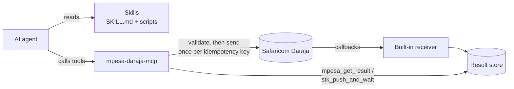

<div align="center">

# MCP and Agent Skills for M-Pesa Daraja API

**Give AI agents safe, working access to Safaricom's M-Pesa Daraja API.**

Agent Skills teach your agent how to integrate M-Pesa. The MCP server lets it call Daraja, with safety rails built in.
Works with Claude Code, Codex, Cursor, GitHub Copilot, Gemini CLI and any agent that supports [Agent Skills](https://agentskills.io) or [MCP](https://modelcontextprotocol.io).

[](https://github.com/Mr-Macharia/mpesa-daraja-skills-and-mcp/actions/workflows/test.yml)
[](https://pypi.org/project/mpesa-daraja-mcp/)
[](https://registry.modelcontextprotocol.io/v0/servers?search=mpesa-daraja-mcp)
[](https://pypi.org/project/mpesa-daraja-mcp/)
[](LICENSE)

[Quick start](#quick-start) · [What's inside](#whats-inside) · [Safety](#safety-model) · [Agent setup](docs/clients.md) · [Tools](mcp-server/README.md#tools)

</div>

---

## Quick start

**1. Install the skills.** They teach your agent the integration. You need Node.js 22.20 or later.

```bash
npx skills add Mr-Macharia/mpesa-daraja-skills-and-mcp
```

**2. Install the MCP server.** It lets your agent call Daraja. You need [uv](https://docs.astral.sh/uv/).

```bash
uvx mpesa-daraja-mcp setup
```

The wizard:
1. asks for your [Daraja](https://developer.safaricom.co.ke/) keys, with secrets typed hidden;
2. checks the keys live with Safaricom;
3. saves them to a config file only you can read;
4. adds the server to Claude Code, Codex, Gemini CLI or Cursor for you.

Restart your agent when it finishes.

<details>
<summary><b>Prefer one command per agent?</b> No keys are needed in the command.</summary>

| Agent | Command |
|---|---|
| Claude Code | `claude mcp add --scope user mpesa -- uvx mpesa-daraja-mcp` |
| Codex | `codex mcp add mpesa -- uvx mpesa-daraja-mcp` |
| Gemini CLI | `gemini mcp add --scope user mpesa uvx mpesa-daraja-mcp` |
| Cursor, VS Code, others | JSON snippets in [docs/clients.md](docs/clients.md#2-mcp-server) |

Then run `uvx mpesa-daraja-mcp setup` to save your keys, or put them in a config file yourself. Both are described in [docs/clients.md](docs/clients.md).
</details>

**3. Ask your agent:**

> *"Check my M-Pesa credentials, then send a KES 1 STK push to 0712345678 and tell me when it's paid."*

The agent calls `mpesa_check_credentials`, then `mpesa_stk_push_and_wait`, and gives one clear answer:

| Result | Meaning |
|---|---|
| `SUCCESS` | Paid. Includes the M-Pesa receipt |
| `FAILED` | Not paid, with the reason, e.g. `1032`: cancelled by the user |
| `UNKNOWN` | Outcome not known yet, with what to check next. It is never retried blindly |

Everything starts in the **sandbox**. No real money can move until you opt in.

## Why

Integrating M-Pesa is full of traps that agents, and people, fall into:

- treating `ResponseCode "0"` as *paid*, when it only means *accepted for processing*;
- building the STK password with a UTC timestamp instead of East Africa Time;
- retrying a payout that timed out, and paying twice;
- "fixing" Daraja's own spellings, such as `RecieverIdentifierType` and `Occassion`, which breaks the request.

This repo packages that knowledge so your agent gets it right the first time.

## What's inside

### 🧠 [15 Agent Skills](skills)
Every major Daraja API: STK Push, C2B, B2C, B2B, tax remittance, Transaction Status, Account Balance, Reversal, Dynamic QR, Ratiba and Bill Manager. Helper skills cover callbacks, sandbox setup and go-live, credentials and security, and troubleshooting.

Each skill is self-contained. It bundles scripts that validate requests, build STK passwords, encrypt credentials and parse callbacks, so the agent runs tested code instead of writing its own.

### 🔌 [MCP server](mcp-server): [`mpesa-daraja-mcp`](https://pypi.org/project/mpesa-daraja-mcp/)
24 `mpesa_*` tools that call Daraja for the agent. `mpesa_stk_push_and_wait` returns a payment's final outcome in one call. An optional built-in callback receiver records results for `mpesa_get_result`.

### 🛡️ Safe by default
Sandbox unless told otherwise. Live money movement stays off until you opt in. Money tools are idempotent, and every request is validated before it is sent. Details are in the [safety model](#safety-model).

### 🪶 Light on context
`DARAJA_TOOLSETS` loads only the tools you use. STK checkout alone costs about 2,100 schema tokens instead of 6,300.

You can use either half on its own: the skills work without the server, and the server works without the skills. Together, the skills tell the agent *which* tool to call and *why*.

### Supported Daraja APIs

| Daraja API | Skill | MCP tools |
|---|---|---|
| OAuth | [daraja-auth](skills/daraja-auth) | `mpesa_check_credentials` |
| M-Pesa Express (STK Push) | [daraja-stk-push](skills/daraja-stk-push) | `mpesa_stk_push_and_wait`<br>`mpesa_stk_push`<br>`mpesa_stk_query` |
| C2B and Pull Transactions | [daraja-c2b](skills/daraja-c2b) | `mpesa_c2b_register_urls`<br>`mpesa_c2b_simulate`<br>`mpesa_pull_transactions` |
| B2C and Pochi la Biashara | [daraja-b2c](skills/daraja-b2c) | `mpesa_b2c_payment` |
| B2B, B2C top-up, B2B Express Checkout | [daraja-b2b](skills/daraja-b2b) | `mpesa_b2b_payment`<br>`mpesa_b2b_express_checkout` |
| Tax remittance (KRA) | [daraja-tax-remittance](skills/daraja-tax-remittance) | `mpesa_b2b_payment` with `PayTaxToKRA` |
| Transaction Status, Account Balance, Reversal | [daraja-account-ops](skills/daraja-account-ops) | `mpesa_transaction_status`<br>`mpesa_account_balance`<br>`mpesa_reverse_transaction` |
| Dynamic QR | [daraja-dynamic-qr](skills/daraja-dynamic-qr) | `mpesa_generate_dynamic_qr` |
| Ratiba (standing orders) | [daraja-ratiba](skills/daraja-ratiba) | `mpesa_ratiba_create_standing_order` |
| Bill Manager | [daraja-bill-manager](skills/daraja-bill-manager) | `mpesa_bill_manager_optin`<br>`mpesa_bill_manager_send_invoice`<br>`mpesa_bill_manager_cancel_invoice` |

Helper skills cover callbacks, sandbox setup and go-live, credentials and security, and troubleshooting. Offline tools explain result codes, normalise phone numbers, build STK passwords and parse callbacks.

## How it works



## Safety model

| Risk | Safeguard |
|---|---|
| Real money moved by accident | Sandbox by default. In production, money tools refuse to run without `DARAJA_ALLOW_LIVE_MONEY_MOVEMENT=true`. They are also flagged as destructive, so clients ask before running them |
| Paying twice on a retry | Each money request is stored under an idempotency key. Repeating the key returns the stored outcome; only a definite failure can be re-sent |
| Reporting "accepted" as "paid" | One result shape: `ACCEPTED`, `SUCCESS`, `FAILED` or `UNKNOWN`. Only a callback or a status query can produce `SUCCESS` |
| Malformed requests | Request bodies are checked against Daraja's rules before sending, using the same validator as the skills |
| Leaked secrets | Tokens and secrets never appear in tool output, and keys never need to go in agent config. Callback URLs carry a secret path token |

Found a security problem? Please report it privately, as described in [SECURITY.md](SECURITY.md).

## Documentation

| Doc | For |
|---|---|
| [docs/clients.md](docs/clients.md) | Setup for each agent: skills folders, MCP config snippets, config files |
| [mcp-server/README.md](mcp-server/README.md) | Every tool, configuration settings, the callback receiver, toolsets |
| [skills/README.md](skills/README.md) | The skill catalogue, and why each skill is built the way it is |
| [AGENTS.md](AGENTS.md) | Rules for AI agents working on M-Pesa code or on this repo |
| [Research.md](Research.md) | Background research: Daraja architecture, OAuth, credentials, sandbox |

## FAQ

**Do I need a Safaricom account?**
You need a free [Daraja developer account](https://developer.safaricom.co.ke/) and a sandbox app for its consumer key and secret. Sandbox shortcode `174379` and its passkey work out of the box for STK Push.

**Will it charge real money?**
Not unless you set `DARAJA_ENV=production` with live keys *and* `DARAJA_ALLOW_LIVE_MONEY_MOVEMENT=true`.

**Why didn't I get a receipt?**
Safaricom sends the receipt to your callback URL. Set `DARAJA_CALLBACK_BASE_URL` to a public HTTPS address, such as an ngrok tunnel to the built-in receiver. Without one, `mpesa_stk_push_and_wait` still reports the outcome through STK Query, but without the receipt number. See [the callback receiver](mcp-server/README.md#results-and-callbacks).

**My agent says "Connection closed".**
Run `uvx mpesa-daraja-mcp status`. It shows which settings are missing and re-tests your keys. Then restart the agent.

## Development

```bash
git clone https://github.com/Mr-Macharia/mpesa-daraja-skills-and-mcp.git && cd mpesa-daraja-skills-and-mcp
pip install -e "mcp-server[dev]"
uvx ruff check .                 # lint
python tools/sync_skills.py      # regenerate skill scripts from their single sources
pytest mcp-server                # tests; no network or credentials needed
```

CI runs:
- lint;
- the skill-script sync check;
- tests on Python 3.10–3.13;
- a package build.

Publishing a `v*` release sends the package to PyPI and the MCP Registry. See [CONTRIBUTING.md](CONTRIBUTING.md).

## Contributing

Bug reports, Daraja corrections and new skills are welcome. Please read [CONTRIBUTING.md](CONTRIBUTING.md) and follow the [Code of Conduct](CODE_OF_CONDUCT.md). Changes are recorded in [CHANGELOG.md](CHANGELOG.md).

If this project saves you time, a ⭐ helps others find it.

## License

[MIT](LICENSE) © 2026 Mr-Macharia

---

<sub>This is an independent open-source project. It is not affiliated with or endorsed by Safaricom PLC. M-Pesa and Daraja are trademarks of Safaricom PLC. When you go live, you are responsible for complying with Safaricom's terms and with payments regulation.</sub>
