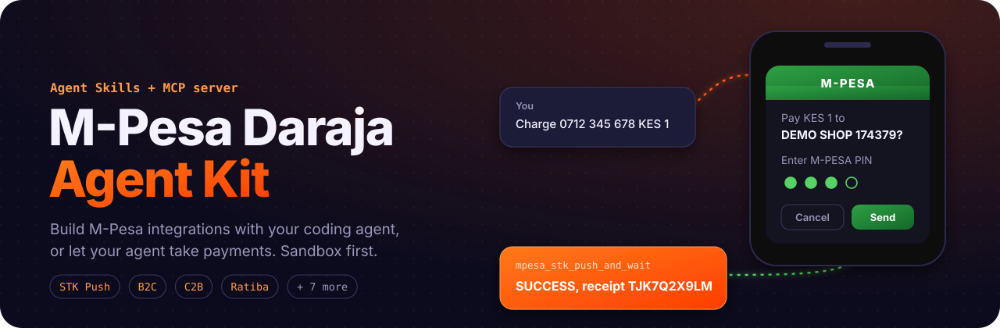
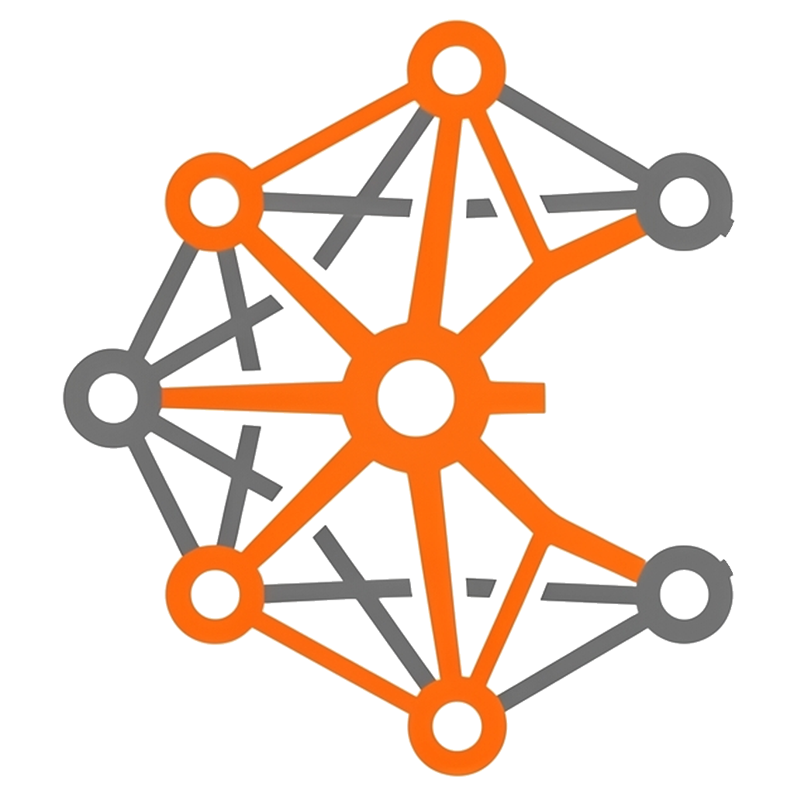
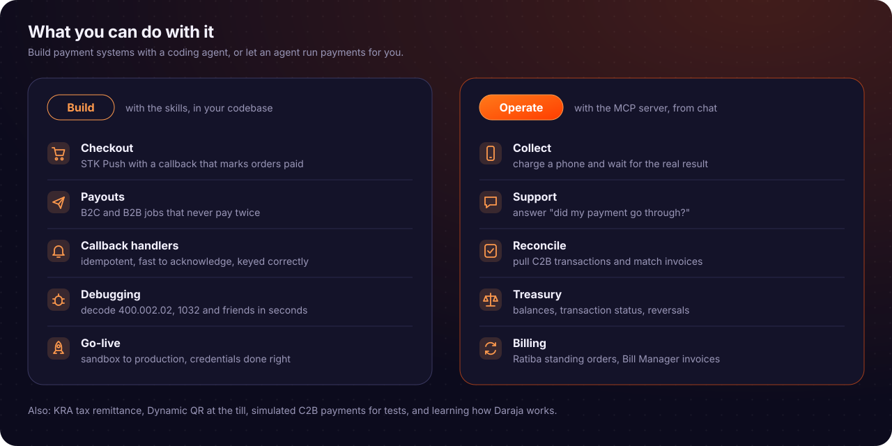
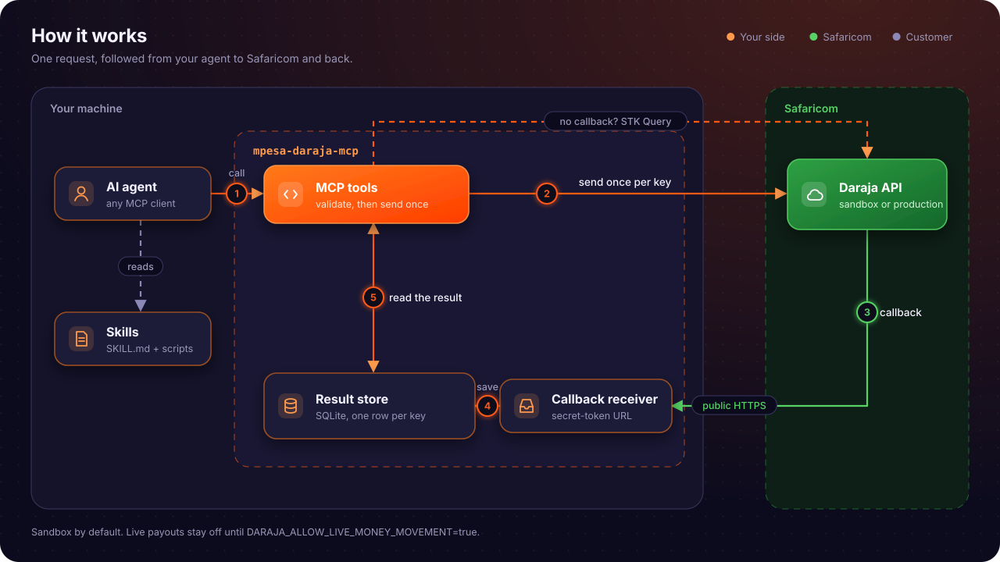

<div align="center">



<br>

[](https://github.com/Mr-Macharia/mpesa-daraja-skills-and-mcp/actions/workflows/test.yml) [](https://pypi.org/project/mpesa-daraja-mcp/) [](https://registry.modelcontextprotocol.io/v0/servers?search=mpesa-daraja-mcp) [](https://pypi.org/project/mpesa-daraja-mcp/) [](LICENSE)
[](https://www.npmjs.com/package/mpesa-daraja) [](https://www.npmjs.com/package/n8n-nodes-daraja-mpesa) [](https://agent-kit.gichogumacharia.tech/)
[](https://m8ven.ai/mcp/mr-macharia/mpesa-daraja-skills-and-mcp?s=readme)




**M-Pesa Daraja Agent Kit: Agent Skills that teach your agent to use Daraja API, and an MCP server that lets it call Daraja safely.**<br>
Plus the `mpesa` CLI, a Node library with Vercel AI SDK tools, n8n nodes, and adapters for LangChain, OpenAI Agents, Agno, Google ADK and CrewAI.<br>
Works with Claude Code, Codex, Cursor, GitHub Copilot, Gemini CLI, and any agent that supports [Agent Skills](https://agentskills.io) or [MCP](https://modelcontextprotocol.io).

[Website](https://agent-kit.gichogumacharia.tech/) &nbsp;&nbsp;|&nbsp;&nbsp; [Use cases](#use-cases) &nbsp;&nbsp;|&nbsp;&nbsp; [Choose a setup](#three-ways-to-use-it) &nbsp;&nbsp;|&nbsp;&nbsp; [Quick start](#quick-start) &nbsp;&nbsp;|&nbsp;&nbsp; [Safety](#safety) &nbsp;&nbsp;|&nbsp;&nbsp; [Docs](#documentation)


</div>

<br>

## Use cases



### Who it helps

| Team | What the kit does for them |
|---|---|
| **Developers** | A coding agent that writes correct Daraja code: STK checkout, B2C payouts, callback handlers, retries that never pay twice. It also reviews and fixes an existing integration |
| **Online shops and SaaS** | Checkout at the till or in the app, Dynamic QR at the counter, subscriptions through Ratiba standing orders |
| **Support teams** | An agent that answers "did my payment go through?" from the transaction itself, not a guess |
| **Finance and operations** | Reconciling C2B payments against invoices, balance checks, reversals and status lookups from chat |
| **Platforms that pay people** | Payouts to drivers, riders, agents and suppliers, safe to retry because every request is idempotent |
| **Landlords, schools, chamas and SACCOs** | Invoices and reminders through Bill Manager, contributions collected by STK Push |
| **Businesses filing tax** | KRA remittance through B2B, with the right command and fields |
| **Anyone learning Daraja** | Sandbox experiments with real responses, and docs that explain why each rule exists |

### What to ask your agent

| Ask | Uses |
|---|---|
| *"Add M-Pesa checkout to my Django order flow, with a callback that marks orders paid."* | Skills |
| *"Send KES 250 to 0712345678 for order #1042 and wait for the result."* | MCP |
| *"Build a B2C payout job for driver earnings that never pays twice."* | Skills |
| *"A customer says they paid. Did receipt TJK7Q2X9LM go through?"* | MCP |
| *"My STK push returns 400.002.02. What's wrong with this request?"* | Skills |
| *"Pull yesterday's C2B transactions and match them against my invoices."* | Both |
| *"Set up a monthly KES 500 standing order for this subscriber."* | Both |
| *"Opt my paybill into Bill Manager and invoice these 20 tenants."* | Both |

## Three ways to use it

The two halves are independent. Pick the one that fits the job, or use both.

<table>
<tr>
<th width="33%" align="left">Skills only</th>
<th width="33%" align="left">MCP server only</th>
<th width="33%" align="left">Skills + MCP server <sub>recommended</sub></th>
</tr>
<tr valign="top">
<td>

Your agent **writes M-Pesa code** for your app: STK checkout, B2C payouts, callback handlers. The skills give it Daraja's rules and tested scripts, so the code is right the first time.

**Pick this when** you're building an integration in your own codebase.

</td>
<td>

Your agent **calls Daraja for you**: sends an STK push, checks a balance, looks up a transaction, reverses a payment. Nothing to write; results come back as `SUCCESS`, `FAILED` or `UNKNOWN`.

**Pick this when** you want to operate M-Pesa from chat, or test against the sandbox.

</td>
<td>

The skills tell your agent **which** tool to call and **why**. The server makes the call safely. Build the integration and try it live in the same conversation.

**Pick this when** you want the agent to build *and* verify.

</td>
</tr>
<tr valign="top">
<td>

```bash
npx skills add \
  Mr-Macharia/mpesa-daraja-skills-and-mcp
```

</td>
<td>

```bash
uvx mpesa-daraja-mcp init
```

</td>
<td>

Run both commands.

</td>
</tr>
</table>

## Quick start

### Let your agent install it

Paste this into Claude Code, Codex, Cursor, Gemini CLI or any coding agent:

```text
Install the M-Pesa Daraja Agent Kit for me:
1. Install the Agent Skills for yourself: npx skills add Mr-Macharia/mpesa-daraja-skills-and-mcp -a <your agent id>
   (agent ids: claude-code, codex, cursor, github-copilot, gemini-cli). Use -g if I want them in every project.
2. Add the MCP server to yourself, named "mpesa", with the command: uvx mpesa-daraja-mcp
   It needs no keys in your config. If uv is missing, tell me how to install it first.
3. Don't ask me for my Daraja keys. Tell me to run `uvx mpesa-daraja-mcp init` in my own terminal,
   which saves them privately, then to restart you.
4. After I restart you, call mpesa_check_credentials and tell me if everything works.
```

Your agent installs both halves; you only type your Daraja keys into the setup wizard, never into the chat.

### Claude Code: one plugin for both

The plugin installs all 22 skills and the MCP server in one step. The server runs through [uv](https://docs.astral.sh/uv/), so install that first, and make sure `uvx` is on the PATH Claude Code sees:

```text
/plugin install mpesa-daraja-skills --marketplace Mr-Macharia/mpesa-daraja-skills-and-mcp
```

Then run `uvx mpesa-daraja-mcp init` once in a terminal to save your Daraja keys. When it offers to add the server to Claude Code, answer **n**: the plugin already did. Restart Claude Code.

### Or install it yourself

**1. Install the skills.** Needs Node.js 22.20 or later.

```bash
npx skills add Mr-Macharia/mpesa-daraja-skills-and-mcp
```

**2. Install the MCP server.** Needs [uv](https://docs.astral.sh/uv/).

Or install the `mpesa` CLI with one line (it installs uv if it's missing):

```bash
curl -LsSf https://agent-kit.gichogumacharia.tech/install.sh | sh   # macOS, Linux
```

```powershell
irm https://agent-kit.gichogumacharia.tech/install.ps1 | iex   # Windows
```

```bash
uvx mpesa-daraja-mcp init
```

The wizard asks for your [Daraja](https://developer.safaricom.co.ke/) keys (secrets are typed hidden), checks them live with Safaricom, saves them to a file only you can read, and registers the server with Claude Code, Codex, Gemini CLI or Cursor. Restart your agent when it's done.

<details>
<summary><b>Add the server to one agent by hand</b></summary>
<br>

No keys go in these commands; the server reads them from its config file.

| Agent | Command |
|---|---|
| Claude Code | `claude mcp add --scope user mpesa -- uvx mpesa-daraja-mcp` |
| Codex | `codex mcp add mpesa -- uvx mpesa-daraja-mcp` |
| Gemini CLI | `gemini mcp add --scope user mpesa uvx mpesa-daraja-mcp` |
| Cursor, VS Code, others | JSON snippets in [docs/clients.md](docs/clients.md#2-mcp-server) |

Then run `uvx mpesa-daraja-mcp init` to save your keys, or write the config file yourself as described in [docs/clients.md](docs/clients.md).
</details>

### Try it

> Check my M-Pesa credentials, then send a KES 1 STK push to 0712345678 and tell me when it's paid.

The agent calls `mpesa_check_credentials`, then `mpesa_stk_push_and_wait`, and answers with one of three results:

| Result | Meaning |
|---|---|
| `SUCCESS` | Paid. Includes the M-Pesa receipt number |
| `FAILED` | Not paid, with the reason, e.g. `1032`: the customer cancelled |
| `UNKNOWN` | Not known yet, with what to check next. Never retried blindly |

Everything starts in the **sandbox**. No real money moves until you opt in.

## How it works



## Why this exists

M-Pesa Daraja Agent Kit makes M-Pesa payment handling and integration easier for:

- **Developers** building payment integration systems. With the kit, your coding agent knows the Daraja API, so you describe the integration and review the code, instead of piecing it together from the portal. Test it all in the sandbox before going live.
- **Learners** finding out how the Daraja API works. Send real requests to the sandbox, a safe test environment, see what comes back, and read [docs](docs/README.md) that explain why each step exists.
- **Businesses and teams** that want an AI agent to handle payments: collecting them, checking whether they went through, and reconciling them through an agent.

## What's inside

**[22 Agent Skills](skills).** Use-case recipes (checkout, payouts, Paybill collections, recurring billing, an agent that sells), a payment-design skill (ledger, refunds, reconciliation, go-live), a sandbox tutor with a build-your-own-gateway track, every major Daraja API, plus helper skills for callbacks, sandbox setup and go-live, credentials and security, and troubleshooting. Each skill bundles tested scripts that validate requests, build STK passwords, encrypt credentials and parse callbacks, so the agent runs known-good code instead of improvising.

**[The MCP server](mcp-server), [`mpesa-daraja-mcp`](https://pypi.org/project/mpesa-daraja-mcp/).** 24 `mpesa_*` tools. `mpesa_stk_push_and_wait` returns a payment's final outcome in one call, and an optional built-in callback receiver records results for `mpesa_get_result`.

**[The Node library](node/packages/mpesa-daraja), [`mpesa-daraja`](https://www.npmjs.com/package/mpesa-daraja) on npm.** The same Daraja calls, validation, idempotency and guardrails for Node apps, plus tools for the Vercel AI SDK. It passes the same [shared fixtures](shared/fixtures) as the Python package.

**[n8n nodes](node/packages/n8n-nodes-daraja-mpesa), [`n8n-nodes-daraja-mpesa`](https://www.npmjs.com/package/n8n-nodes-daraja-mpesa) on npm.** An M-Pesa Daraja node for STK Push, payouts and status checks, and an M-Pesa Trigger that starts a workflow on each callback. For n8n workflows without an AI agent.

**Load only what you need.** Every tool the server offers takes up space in your agent's context, even when it's never called. Set `DARAJA_TOOLSETS` to the groups you use, and the agent sees only those tools. For example, `DARAJA_TOOLSETS=stk` for a shop that only takes STK payments, or `stk,payouts` if it also pays people. The groups are `stk`, `c2b`, `payouts`, `ops`, `qr`, `ratiba` and `billmanager`; the basic tools (`core`) are always on. Leave it unset to load everything.

<details>
<summary><b>Supported Daraja APIs, skills and tools</b></summary>
<br>

| Daraja API | Skill | MCP tools |
|---|---|---|
| OAuth | [daraja-auth](skills/daraja-auth) | `mpesa_check_credentials` |
| M-Pesa Express (STK Push) | [daraja-stk-push](skills/daraja-stk-push) | `mpesa_stk_push_and_wait`<br>`mpesa_stk_push`<br>`mpesa_stk_query` |
| C2B and Pull Transactions | [daraja-c2b](skills/daraja-c2b) | `mpesa_c2b_register_urls`<br>`mpesa_c2b_simulate`<br>`mpesa_pull_transactions` |
| B2C and Pochi la Biashara | [daraja-b2c](skills/daraja-b2c) | `mpesa_b2c_payment` |
| B2B, B2C top-up, B2B Express Checkout | [daraja-b2b](skills/daraja-b2b) | `mpesa_b2b_payment`<br>`mpesa_b2b_express_checkout` |
| Tax remittance (KRA) | [daraja-tax-remittance](skills/daraja-tax-remittance) | `mpesa_b2b_payment` with `PayTaxToKRA` |
| Transaction Status, Account Balance, Reversal | [daraja-account-ops](skills/daraja-account-ops) | `mpesa_transaction_status`<br>`mpesa_account_balance`<br>`mpesa_reverse_transaction` |
| Dynamic QR | [daraja-dynamic-qr](skills/daraja-dynamic-qr) | `mpesa_generate_dynamic_qr` |
| Ratiba (standing orders) | [daraja-ratiba](skills/daraja-ratiba) | `mpesa_ratiba_create_standing_order` |
| Bill Manager | [daraja-bill-manager](skills/daraja-bill-manager) | `mpesa_bill_manager_optin`<br>`mpesa_bill_manager_send_invoice`<br>`mpesa_bill_manager_cancel_invoice` |

Offline tools also explain result codes, normalise phone numbers, build STK passwords and parse callbacks, with no Daraja call.
</details>

## Safety

| Risk | Safeguard |
|---|---|
| Moving real money by accident | Sandbox by default. In production, money tools refuse to run until `DARAJA_ALLOW_LIVE_MONEY_MOVEMENT=true`, and they're flagged as destructive so clients ask first |
| An agent paying out too much, or to the wrong person | Optional: `DARAJA_APPROVAL_THRESHOLD` asks you to approve larger payouts in the chat, `DARAJA_ALLOWED_RECIPIENTS` limits who can be paid, and `DARAJA_READ_ONLY=true` removes money tools entirely |
| Paying twice on a retry | Each money request is stored under an idempotency key. Repeating the key returns the stored outcome; only a definite failure can be re-sent |
| Reporting "accepted" as "paid" | Only a callback or a status query can produce `SUCCESS` |
| Malformed requests | Bodies are checked against Daraja's rules before sending, using the same validator as the skills |
| Leaked secrets | Tokens and secrets never appear in tool output, keys never go in agent config, and callback URLs carry a secret path token |

Found a security problem? Report it privately, as described in [SECURITY.md](SECURITY.md).

## FAQ

<details>
<summary><b>Do I need a Safaricom account?</b></summary>
<br>
A free <a href="https://developer.safaricom.co.ke/">Daraja developer account</a> and a sandbox app, for its Consumer Key and Secret. Sandbox shortcode <code>174379</code> and its passkey work out of the box for STK Push.
</details>

<details>
<summary><b>Will it charge real money?</b></summary>
<br>
Only if you set <code>DARAJA_ENV=production</code> with live keys <i>and</i> <code>DARAJA_ALLOW_LIVE_MONEY_MOVEMENT=true</code>.
</details>

<details>
<summary><b>Why didn't I get a receipt?</b></summary>
<br>
Safaricom sends the receipt to your callback URL. Set <code>DARAJA_CALLBACK_BASE_URL</code> to a public HTTPS address, such as an ngrok tunnel to the built-in receiver. Without one, <code>mpesa_stk_push_and_wait</code> still reports the outcome through STK Query, just without the receipt number. See <a href="mcp-server/README.md#results-and-callbacks">the callback receiver</a>.
</details>

<details>
<summary><b>My agent says "Connection closed".</b></summary>
<br>
Run <code>uvx mpesa-daraja-mcp status</code>. It lists missing settings and re-tests your keys. Then restart the agent.
</details>

## Documentation

| Read | For |
|---|---|
| [docs/clients.md](docs/clients.md) | Setup for each agent: skills folders, MCP config, config files |
| [docs/agent-frameworks.md](docs/agent-frameworks.md) | The same tools in LangChain, the OpenAI Agents SDK, Agno, Google ADK, CrewAI, the Vercel AI SDK or your own agent, without the MCP server |
| [node/packages/mpesa-daraja](node/packages/mpesa-daraja) | The Node library: client, callbacks, guardrails and agent tools |
| [node/packages/n8n-nodes-daraja-mpesa](node/packages/n8n-nodes-daraja-mpesa) | n8n community nodes and the M-Pesa Trigger |
| [mcp-server/README.md](mcp-server/README.md) | Every tool and setting, the callback receiver, toolsets |
| [skills/README.md](skills/README.md) | The skill catalogue, and why each skill is built the way it is |
| [docs/](docs/README.md) | How Daraja works: transaction types, callbacks, OAuth, credentials, sandbox |
| [AGENTS.md](AGENTS.md) | Rules for AI agents working on M-Pesa code or on this repo |

## Contributing

Bug reports, Daraja corrections and new skills are welcome. Start with [CONTRIBUTING.md](CONTRIBUTING.md), which covers the dev setup, tests and release process, and follow the [Code of Conduct](CODE_OF_CONDUCT.md). Changes are recorded in [CHANGELOG.md](CHANGELOG.md).

## License

[MIT](LICENSE) © 2026 Mr-Macharia

<sub>An independent open-source project, not affiliated with or endorsed by Safaricom PLC. M-Pesa and Daraja are trademarks of Safaricom PLC. When you go live, you are responsible for complying with Safaricom's terms and payments regulation.</sub>
