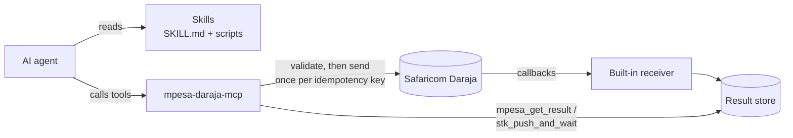

<div align="center">

# Mpesa-MCP

**Give AI agents safe, working access to Safaricom M-Pesa Daraja.**

Agent Skills that teach the integration, and an MCP server that runs it.
For Claude Code, Codex, Cursor, Copilot, Gemini CLI and any agent that speaks [Agent Skills](https://agentskills.io) or [MCP](https://modelcontextprotocol.io).

[](https://github.com/Mr-Macharia/Mpesa-MCP/actions/workflows/test.yml)
[](https://pypi.org/project/mpesa-daraja-mcp/)
[](mcp-server/pyproject.toml)
[](LICENSE)

</div>

---

## Why

Wiring up M-Pesa is full of traps that agents (and people) fall into:
- treating `ResponseCode "0"` as *paid*;
- building the STK password with a UTC timestamp;
- retrying a timed-out payout and paying twice;
- "fixing" Daraja's own spelling of `RecieverIdentifierType`.

This repo packages that hard-won knowledge so an agent gets it right the first time, and then lets the agent call Daraja with safety rails built in.

## What's inside

| | |
|---|---|
| 🧠 **[15 Agent Skills](skills)** | Every major Daraja API: STK Push, C2B, B2C, B2B, tax, status/balance/reversal, Dynamic QR, Ratiba, Bill Manager, callbacks, sandbox setup and go-live, security, troubleshooting. Each skill is self-contained, with bundled scripts that validate requests, build passwords, encrypt credentials and parse callbacks. |
| 🔌 **[MCP server](mcp-server)** (`mpesa-daraja-mcp`) | 23 `mpesa_*` tools. `mpesa_stk_push_and_wait` returns a payment's final outcome in one call. An optional built-in callback receiver feeds `mpesa_get_result`. |
| 🛡️ **Safety by default** | Uses the sandbox unless told otherwise. Live money movement is off until you opt in. Money tools are idempotent, so a repeated key never pays twice. Requests are validated before anything is sent. |
| 🪶 **Context-efficient** | `MPESA_TOOLSETS` loads only what you use: STK-only checkout costs ~2,100 schema tokens instead of ~6,300. |

## How it works



## Quick start

**1. Skills.** Works with any supported agent and needs Node.js 22.20+:

```bash
npx skills add Mr-Macharia/Mpesa-MCP
```

**2. MCP server.** Needs [uv](https://docs.astral.sh/uv/). This example is for Claude Code:

```bash
claude mcp add mpesa \
  -e MPESA_CONSUMER_KEY=... -e MPESA_CONSUMER_SECRET=... \
  -e MPESA_SHORTCODE=174379 -e MPESA_PASSKEY=... \
  -- uvx mpesa-daraja-mcp
```

Codex, Gemini CLI, Cursor, VS Code/Copilot and other clients: see **[docs/clients.md](docs/clients.md)**. Get sandbox keys from the [Daraja portal](https://developer.safaricom.co.ke/); [`.env.example`](.env.example) lists every setting.

**3. Ask your agent:**

> *"Check my M-Pesa credentials, then send a KES 1 STK push to 0712345678 and tell me when it's paid."*

The agent calls `mpesa_check_credentials`, then `mpesa_stk_push_and_wait`, and reports one of:
- `SUCCESS`, with the M-Pesa receipt;
- `FAILED`, with the reason (e.g. `1032`, cancelled by the user);
- `UNKNOWN`, with what to check next.

## Safety model

| Risk | Safeguard |
|---|---|
| Real money moved by accident | Sandbox by default. Production money tools refuse to run without `MPESA_ALLOW_LIVE_MONEY_MOVEMENT=true`, and are flagged destructive so clients ask before running them |
| Paying twice on a retry | Each money request is stored under an idempotency key. A repeat returns the stored outcome; only a definite failure can be re-sent |
| Reporting "accepted" as "paid" | One result shape: `ACCEPTED`, `SUCCESS`, `FAILED` or `UNKNOWN`. Only callbacks or queries produce `SUCCESS` |
| Malformed requests | Bodies are checked against Daraja's rules before sending, with the same validator the skills use |
| Leaked secrets | Tokens and secrets are never returned in tool output. Callbacks need a secret path token |

Found a security problem? See [SECURITY.md](SECURITY.md).

## Documentation

| Doc | For |
|---|---|
| [docs/clients.md](docs/clients.md) | Setup for each agent: skills folders and MCP config snippets |
| [mcp-server/README.md](mcp-server/README.md) | Tools, configuration, the callback receiver, toolsets |
| [skills/README.md](skills/README.md) | The skill catalogue, and why each skill is built the way it is |
| [AGENTS.md](AGENTS.md) | Rules for AI agents working on M-Pesa code or this repo |
| [Content.md](Content.md) | Background research: Daraja architecture, OAuth, credentials, sandbox |

## Development

```bash
pip install -e "mcp-server[dev]"
uvx ruff check .                 # lint
python tools/sync_skills.py      # regenerate skill scripts from their single sources
pytest mcp-server                # tests; no network or credentials needed
```

CI runs lint, the sync check, tests on Python 3.10–3.13, and a package build. Releases publish to PyPI and the MCP Registry when a `v*` tag is pushed. See [CONTRIBUTING.md](CONTRIBUTING.md).

## Contributing

Bug reports, Daraja corrections and new skills are welcome. Please read [CONTRIBUTING.md](CONTRIBUTING.md) and follow the [Code of Conduct](CODE_OF_CONDUCT.md). Changes are tracked in [CHANGELOG.md](CHANGELOG.md).

## License

[MIT](LICENSE) © 2026 Mr-Macharia

---

<sub>This is an independent open-source project, not affiliated with or endorsed by Safaricom PLC. M-Pesa and Daraja are trademarks of Safaricom PLC. You are responsible for complying with Safaricom's terms and with applicable payments regulation when you go live.</sub>
