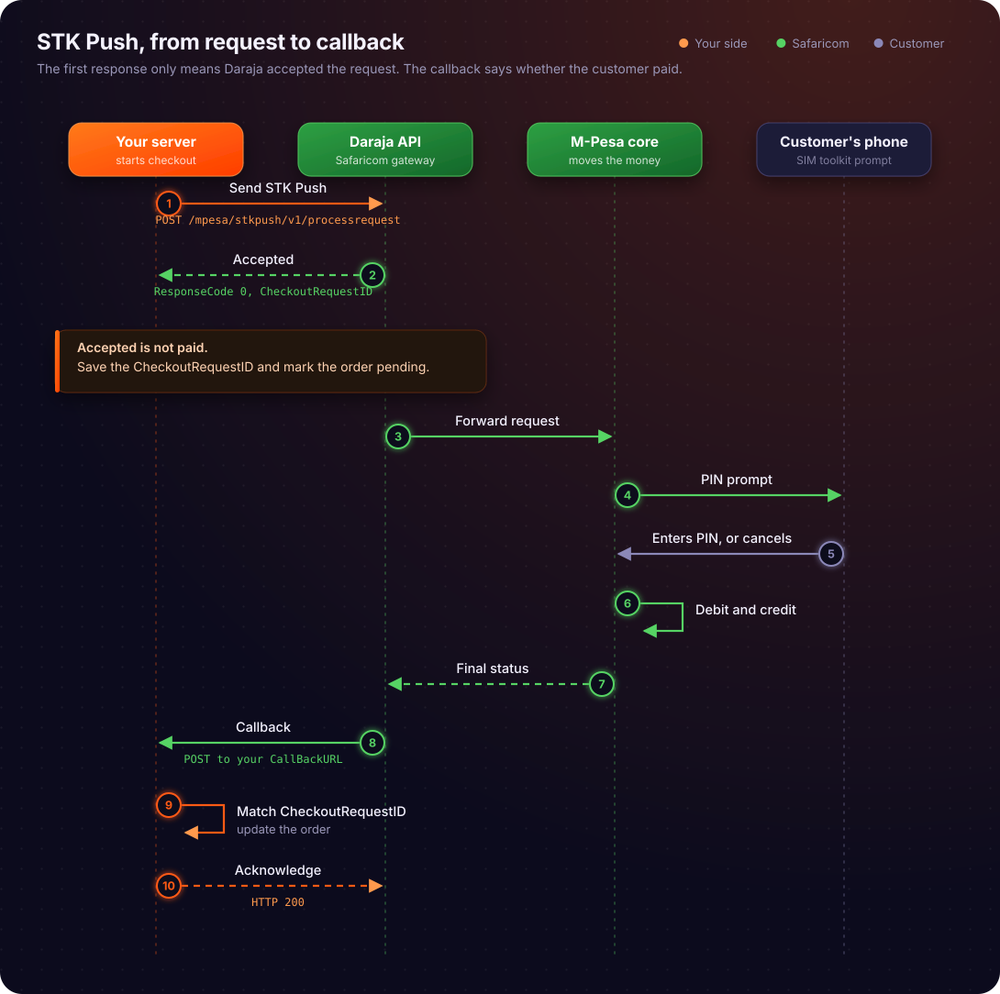

# Daraja's request-response cycle

### Request-Response Cycle

Building upon the transactional flow established in the previous section, where the customer’s authorization and the business’s validation logic define the initial parameters of a payment, we must now examine the underlying communication architecture that facilitates these movements. The Mpesa Daraja platform, Safaricom's developer-facing API gateway, facilitates programmatic interaction with the Mpesa mobile money ecosystem through a sophisticated request-response cycle. A fundamental aspect of integrating with Daraja is understanding its request-response cycle, which often involves both synchronous and asynchronous communication patterns. This dual-phase approach is critical for ensuring system responsiveness, transaction reliability, and scalability within a high-volume financial processing environment. This section will meticulously trace an API call from a developer's server to Safaricom and back, detailing the synchronous and asynchronous phases, defining key concepts, and grounding the explanation in real-world production contexts.

## The Dual Nature of Daraja's Request-Response Cycle

When a developer's application initiates a transaction or query through the Daraja API, the interaction is not always a simple, single request-response exchange. Instead, many critical Mpesa operations, particularly those involving financial movements or external system interactions, employ a two-stage communication model: an immediate **synchronous response** followed by a later **asynchronous callback**. This design addresses the inherent complexities of distributed transaction processing, network latencies, and the need for immediate feedback on request reception while deferring the final outcome until all internal processes are complete.

### Synchronous Response: Immediate Acknowledgment

A **synchronous response** refers to the immediate feedback an API client receives from the server after making a request. In the context of Daraja, this response is delivered over the same HTTP connection that initiated the request. Its primary purpose is to acknowledge receipt of the request and provide an initial status regarding its validity and whether it has been accepted for processing. This immediate response is crucial for the requesting application to understand if its request was syntactically correct, authenticated, and initially accepted by the Daraja gateway.

**Why it exists:** The synchronous response serves several vital functions. Firstly, it provides instant validation feedback. If a request is malformed, lacks proper authentication credentials, or contains invalid parameters, the Daraja API can immediately reject it and inform the client. This prevents unnecessary processing of invalid requests. Secondly, it offers an immediate confirmation that the request has reached the Daraja system and has been queued for further processing. This allows the client application to proceed without blocking indefinitely, improving user experience and system responsiveness. However, it is paramount to understand that a successful synchronous response (e.g., an "Accepted" status) does *not* signify the final success or failure of the underlying Mpesa transaction. It merely confirms that the request has been successfully handed over to Safaricom's internal systems for execution.

**How it works step by step:**

1.  **Client Initiates Request:** The developer's server constructs an HTTP POST request (e.g., for an STK Push, B2C payment, or C2B Register URL) with the necessary JSON payload and authentication headers.
2.  **Request Sent to Daraja:** This request is sent over the internet to the Daraja API endpoint.
3.  **Daraja Gateway Receives and Validates:** The Daraja API gateway receives the request. It performs initial checks:
    *   **Authentication:** Verifies the provided access token.
    *   **Authorization:** Checks if the authenticated application has permission to perform the requested operation.
    *   **Syntax and Schema Validation:** Ensures the JSON payload conforms to the expected structure and data types.
    *   **Basic Business Rule Validation:** Performs quick checks, such as ensuring mandatory fields are present.
4.  **Immediate Response Generation:** Based on these initial validations, Daraja generates a synchronous HTTP response.
    *   If any validation fails, an error response (e.g., HTTP 400 Bad Request, 401 Unauthorized, 403 Forbidden) is returned immediately, often with a specific error code and message.
    *   If all initial validations pass, Daraja returns an HTTP 200 OK status, typically with a JSON payload indicating that the request has been accepted for processing. This payload often includes a `ConversationID` and sometimes an `OriginatorConversationID` or `CheckoutRequestID` (for STK Push).
5.  **Client Receives Response:** The developer's server receives this immediate response. The application should parse this response to determine if the request was initially accepted or rejected.

**Key Identifier: ConversationID**
The **ConversationID** is a unique identifier generated by the Daraja API for each successful synchronous request. It acts as a crucial correlation token, linking the initial request made by the developer's application to the subsequent internal processing within Safaricom's systems. While the `ConversationID` is returned in the synchronous response, it is primarily used internally by Safaricom for tracking. For external correlation by the developer, other IDs like `OriginatorConversationID` (a unique ID generated by the client for their request) or `CheckoutRequestID` (specific to STK Push) are more commonly used to match the final asynchronous callback to the originating request. However, the `ConversationID` is a fundamental concept representing the unique lifecycle of a request within the Daraja ecosystem.

### Asynchronous Callback: Final Transaction Status

An **asynchronous callback** is a mechanism where, instead of providing the final result immediately, the Daraja API initiates a separate, new HTTP request back to a pre-configured URL on the developer's server once the underlying Mpesa transaction has completed its processing. This callback delivers the definitive status of the transaction (success, failure, timeout, etc.) along with detailed transaction parameters.

**Why it exists:** The asynchronous callback mechanism is essential for several reasons:
1.  **Long-Running Processes:** Mpesa transactions can involve multiple internal systems, network hops, and even human interaction (e.g., customer PIN entry for STK Push). These processes are not instantaneous and can take several seconds or even minutes. Holding open an HTTP connection for such durations is impractical and inefficient for both the client and the server.
2.  **Decoupling:** It decouples the request initiation from the result delivery. The client doesn't need to wait actively; it can process the immediate acknowledgment and then handle the final result when it arrives.
3.  **Reliability:** Callbacks are often designed with retry mechanisms. If the developer's server is temporarily unavailable when Daraja attempts to send a callback, Daraja's system will typically retry sending the notification for a defined period, enhancing delivery reliability.
4.  **Scalability:** By not keeping connections open, Daraja can handle a much higher volume of concurrent requests, as resources are freed up quickly after sending the synchronous acknowledgment.

**How it works step by step:**

1.  **Internal Processing:** After sending the synchronous response, Daraja's internal systems proceed to execute the requested Mpesa transaction. This might involve:
    *   Queueing the request for processing by the Mpesa core system.
    *   Interacting with customer accounts (debiting/crediting).
    *   Sending notifications to end-users (e.g., STK Push prompt).
    *   Waiting for user input (e.g., PIN entry).
    *   Updating transaction ledgers.
2.  **Transaction Completion:** Once the Mpesa transaction reaches a final state (success, failure, cancellation, timeout), Daraja's backend system prepares the final transaction details.
3.  **Callback Request Generation:** Daraja constructs an HTTP POST request containing the final transaction status and details in a JSON payload.
4.  **Callback Sent to Developer's URL:** This request is sent to the **callback URL** (also known as a validation URL or confirmation URL, depending on the API call) that the developer configured when initiating the transaction or registering their service.
5.  **Developer Server Receives Callback:** The developer's server, acting as a webhook receiver, listens for incoming POST requests on the specified callback URL.
6.  **Developer Server Processes Callback:** The application on the developer's server:
    *   Receives the JSON payload.
    *   Parses the transaction details (e.g., `ResultCode`, `ResultDesc`, `TransactionID`, `Amount`, `MSISDN`).
    *   Uses a correlation ID (like `CheckoutRequestID` for STK Push or `OriginatorConversationID` for B2C/C2B) to match this callback to the original request initiated by the application.
    *   Updates its internal database with the final transaction status.
    *   Responds to Daraja with an HTTP 200 OK status to acknowledge successful receipt of the callback. If the developer's server responds with anything other than 200 OK, Daraja might retry sending the callback.

## Step-by-Step Trace: STK Push API Call Example

To illustrate the synchronous and asynchronous phases concretely, let's trace an STK Push (Sim Tool Kit Push) transaction, a common Mpesa integration scenario where a business initiates a payment request to a customer's phone.

### Scenario: A customer wants to pay for goods on an e-commerce website using Mpesa. The website initiates an STK Push to the customer's phone.

1.  **Developer Server (E-commerce Website Backend) Action:**
    *   The customer clicks "Pay with Mpesa" on the website.
    *   The e-commerce backend prepares an STK Push request. This involves:
        *   Generating a unique `OriginatorConversationID` for its internal tracking.
        *   Specifying the `Amount`, `PhoneNumber`, `AccountReference`, `TransactionDesc`.
        *   Crucially, it includes a `CallBackURL` where Daraja should send the final transaction status.
        *   It obtains an access token from Daraja's OAuth endpoint.
        *   It encrypts the `Passkey` and `Timestamp` to generate the `Password` for the request.
    *   The server sends an HTTP POST request to the Daraja STK Push endpoint (`/mpesa/stkpush/v1/processrequest`).

2.  **Daraja API (Synchronous Phase):**
    *   Daraja receives the STK Push request.
    *   It performs immediate validations: authentication token, request payload structure, basic parameter validity.
    *   If valid, Daraja returns an HTTP 200 OK response to the e-commerce server.
    *   This synchronous response contains:
        *   `MerchantRequestID`: A unique ID generated by Daraja for this specific merchant request.
        *   `CheckoutRequestID`: A unique ID generated by Daraja for this specific STK Push transaction, which is critical for correlating the asynchronous callback.
        *   `ResponseCode`: Typically "0" for success, indicating the request was accepted.
        *   `ResponseDescription`: A human-readable description (e.g., "Success. Request accepted for processing").
        *   `CustomerMessage`: A message displayed to the customer on their phone (e.g., "Success. Please enter your M-PESA PIN to complete the transaction.").
    *   At this point, the e-commerce server knows that the STK Push prompt has been sent to the customer's phone. It *does not* know if the customer has entered their PIN or if the transaction will succeed.

3.  **Mpesa Backend Processing:**
    *   Daraja forwards the request to the Mpesa core system.
    *   The Mpesa system sends an STK Push prompt to the customer's mobile phone.
    *   The customer receives the prompt, reviews the transaction details, and enters their Mpesa PIN.
    *   The Mpesa system processes the payment: debits the customer's account, credits the business's till number, and updates transaction records.
    *   The Mpesa system determines the final status (e.g., successful, insufficient funds, user cancelled, timeout).

4.  **Daraja API (Asynchronous Phase - Callback):**
    *   Once the Mpesa transaction is complete, Daraja's system constructs a callback payload with the final transaction details.
    *   This payload includes:
        *   `MerchantRequestID` and `CheckoutRequestID` (to correlate with the initial request).
        *   `ResultCode`: "0" for success, or other codes for various failures (e.g., 1032 for cancelled, 1031 for insufficient funds).
        *   `ResultDesc`: A detailed description of the outcome.
        *   `MpesaReceiptNumber`: The unique Mpesa transaction ID if successful.
        *   `TransactionDate`, `Amount`, `PhoneNumber`, etc.
    *   Daraja sends an HTTP POST request to the `CallBackURL` provided by the e-commerce server in the initial STK Push request.

5.  **Developer Server (E-commerce Website Backend) Action:**
    *   The e-commerce server's designated callback endpoint receives the POST request from Daraja.
    *   It parses the JSON payload.
    *   It uses the `CheckoutRequestID` to find the corresponding pending transaction in its own database.
    *   Based on the `ResultCode` and `ResultDesc`, it updates the transaction status in its database (e.g., "Payment Successful", "Payment Failed - Insufficient Funds").
    *   It might then trigger further actions, such as updating the order status, sending a confirmation email to the customer, or displaying a success/failure message on the website.
    *   Crucially, the e-commerce server responds to Daraja with an HTTP 200 OK to acknowledge receipt of the callback.

This entire flow ensures that the e-commerce website gets immediate feedback that the payment process has started, and definitive feedback once the payment is actually completed or failed, without having to continuously poll Daraja for status updates.

## Visualizing the Request-Response Cycle

The following Mermaid sequence diagram illustrates the complete flow for an STK Push transaction, highlighting the distinct synchronous and asynchronous interactions.



## Code Example: Python Implementation for STK Push and Callback Handling

This example demonstrates how a Python Flask application would initiate an STK Push and then handle the asynchronous callback.

### Prerequisites:
*   `requests` library for HTTP calls.
*   `Flask` for creating a web server to handle callbacks.
*   `python-dotenv` for environment variables.
*   Ngrok or a similar tool to expose your local Flask server to the internet for Daraja to send callbacks.

```python
import os
import base64
import datetime
import requests
import json
from flask import Flask, request, jsonify
from dotenv import load_dotenv

# Load environment variables from .env file
load_dotenv()

app = Flask(__name__)

# --- Configuration from Environment Variables ---
CONSUMER_KEY = os.getenv("DARAJA_CONSUMER_KEY")
CONSUMER_SECRET = os.getenv("DARAJA_CONSUMER_SECRET")
BUSINESS_SHORT_CODE = os.getenv("DARAJA_BUSINESS_SHORT_CODE") # Your Paybill/Till Number
PASSKEY = os.getenv("DARAJA_PASSKEY")
CALLBACK_URL = os.getenv("DARAJA_CALLBACK_URL") # Your public URL for callbacks (e.g., ngrok URL)
DARAJA_ENV = os.getenv("DARAJA_ENV", "sandbox") # 'sandbox' or 'production'

if DARAJA_ENV == "sandbox":
    BASE_URL = "https://sandbox.safaricom.co.ke"
else:
    BASE_URL = "https://api.safaricom.co.ke"

# --- Helper Function to Get Access Token ---
def get_access_token():
    """
    Retrieves an OAuth access token from Daraja API.
    """
    url = f"{BASE_URL}/oauth/v1/generate?grant_type=client_credentials"
    try:
        response = requests.get(url, auth=(CONSUMER_KEY, CONSUMER_SECRET))
        response.raise_for_status() # Raise an exception for HTTP errors
        token_data = response.json()
        return token_data.get("access_token")
    except requests.exceptions.RequestException as e:
        print(f"Error getting access token: {e}")
        return None

# --- STK Push Initiation Function ---
def initiate_stk_push(phone_number, amount, account_reference, transaction_desc):
    """
    Initiates an STK Push transaction.
    """
    access_token = get_access_token()
    if not access_token:
        return {"error": "Failed to get access token"}, 500

    timestamp = datetime.datetime.now().strftime("%Y%m%d%H%M%S")
    password_str = f"{BUSINESS_SHORT_CODE}{PASSKEY}{timestamp}"
    password = base64.b64encode(password_str.encode()).decode("utf-8")

    url = f"{BASE_URL}/mpesa/stkpush/v1/processrequest"
    headers = {
        "Authorization": f"Bearer {access_token}",
        "Content-Type": "application/json"
    }
    payload = {
        "BusinessShortCode": BUSINESS_SHORT_CODE,
        "Password": password,
        "Timestamp": timestamp,
        "TransactionType": "CustomerPayBillOnline", # Or CustomerBuyGoodsOnline
        "Amount": amount,
        "PartyA": phone_number, # Customer's phone number
        "PartyB": BUSINESS_SHORT_CODE,
        "PhoneNumber": phone_number,
        "CallBackURL": CALLBACK_URL,
        "AccountReference": account_reference, # Your internal reference for the transaction
        "TransactionDesc": transaction_desc
    }

    try:
        response = requests.post(url, headers=headers, json=payload)
        response.raise_for_status()
        return response.json(), 200
    except requests.exceptions.RequestException as e:
        print(f"Error initiating STK Push: {e}")
        if e.response:
            return e.response.json(), e.response.status_code
        return {"error": str(e)}, 500

# --- Flask Endpoint to Trigger STK Push (Example) ---
@app.route("/trigger_stk", methods=["POST"])
def trigger_stk():
    data = request.get_json()
    phone = data.get("phone")
    amount = data.get("amount")
    ref = data.get("reference", "ORDER123")
    desc = data.get("description", "Payment for goods")

    if not all([phone, amount]):
        return jsonify({"message": "Phone number and amount are required"}), 400

    # In a real application, you'd store the initial request details
    # in a database, linked by a unique ID you generate,
    # and then use CheckoutRequestID from the response to update it.
    print(f"Initiating STK Push for {phone}, amount {amount}")
    stk_response, status_code = initiate_stk_push(phone, amount, ref, desc)

    if status_code == 200 and stk_response.get("ResponseCode") == "0":
        # Synchronous success: Request accepted by Daraja
        checkout_request_id = stk_response.get("CheckoutRequestID")
        merchant_request_id = stk_response.get("MerchantRequestID")
        print(f"STK Push initiated successfully. CheckoutRequestID: {checkout_request_id}")
        # Store checkout_request_id in your database with a PENDING status
        return jsonify({
            "message": "STK Push initiated. Waiting for customer PIN.",
            "checkout_request_id": checkout_request_id,
            "merchant_request_id": merchant_request_id
        }), 200
    else:
        # Synchronous failure: Daraja rejected the request
        print(f"STK Push initiation failed: {stk_response}")
        return jsonify({
            "message": "Failed to initiate STK Push",
            "details": stk_response
        }), status_code

# --- Flask Endpoint for Asynchronous Callback ---
@app.route("/mpesa_callback", methods=["POST"])
def mpesa_callback():
    """
    Receives and processes the asynchronous callback from Daraja.
    """
    try:
        callback_data = request.get_json()
        print("Received Mpesa Callback:")
        print(json.dumps(callback_data, indent=2))

        # Extract relevant data
        body = callback_data.get("Body", {})
        stk_callback = body.get("stkCallback", {})
        checkout_request_id = stk_callback.get("CheckoutRequestID")
        result_code = stk_callback.get("ResultCode")
        result_desc = stk_callback.get("ResultDesc")
        merchant_request_id = stk_callback.get("MerchantRequestID")

        # Process the callback based on ResultCode
        if result_code == 0:
            # Transaction was successful
            callback_metadata = stk_callback.get("CallbackMetadata", {})
            item_list = callback_metadata.get("Item", [])
            mpesa_receipt_number = None
            amount = None
            phone_number = None
            transaction_date = None

            for item in item_list:
                if item.get("Name") == "MpesaReceiptNumber":
                    mpesa_receipt_number = item.get("Value")
                elif item.get("Name") == "Amount":
                    amount = item.get("Value")
                elif item.get("Name") == "PhoneNumber":
                    phone_number = item.get("Value")
                elif item.get("Name") == "TransactionDate":
                    transaction_date = item.get("Value")

            print(f"Transaction SUCCESS for CheckoutRequestID: {checkout_request_id}")
            print(f"Mpesa Receipt: {mpesa_receipt_number}, Amount: {amount}, Phone: {phone_number}")
            # --- IMPORTANT: Update your database here ---
            # Find the transaction by checkout_request_id and update its status to SUCCESS
            # Store mpesa_receipt_number, amount, transaction_date
            # Trigger any post-payment actions (e.g., fulfill order, send confirmation)

        else:
            # Transaction failed or was cancelled
            print(f"Transaction FAILED/CANCELLED for CheckoutRequestID: {checkout_request_id}")
            print(f"Result Code: {result_code}, Description: {result_desc}")
            # --- IMPORTANT: Update your database here ---
            # Find the transaction by checkout_request_id and update its status to FAILED/CANCELLED
            # Log the result_code and result_desc for debugging

        # Always return a 200 OK to Daraja to acknowledge receipt
        return jsonify({"ResultCode": 0, "ResultDesc": "Callback received successfully"}), 200

    except Exception as e:
        print(f"Error processing Mpesa callback: {e}")
        # Log the error, but still return 200 OK to prevent Daraja from retrying
        # if the issue is with our processing, not Daraja's delivery.
        # For critical errors, you might return a 500 to trigger retries,
        # but be careful not to create an infinite loop if the error is persistent.
        return jsonify({"ResultCode": 1, "ResultDesc": "Error processing callback"}), 200 # Or 500 if you want retries

if __name__ == "__main__":
    app.run(debug=True, port=5000)
```

### `.env` file example:
```
DARAJA_CONSUMER_KEY=your_consumer_key
DARAJA_CONSUMER_SECRET=your_consumer_secret
DARAJA_BUSINESS_SHORT_CODE=600XXX
DARAJA_PASSKEY=your_passkey
DARAJA_CALLBACK_URL=https://your-ngrok-url.ngrok-free.app/mpesa_callback
DARAJA_ENV=sandbox
```

**Explanation of the Code:**

*   **`get_access_token()`**: Handles OAuth authentication to get a bearer token, which is required for all Daraja API calls.
*   **`initiate_stk_push()`**:
    *   Constructs the `Password` by base64 encoding `BusinessShortCode + Passkey + Timestamp`.
    *   Builds the JSON payload with all required parameters, including the `CallBackURL`.
    *   Sends the POST request to the STK Push endpoint.
    *   Returns the synchronous response from Daraja.
*   **`/trigger_stk` endpoint**:
    *   This is an example endpoint on your server that a frontend or another service might call to start an STK Push.
    *   It calls `initiate_stk_push`.
    *   It processes the *synchronous response*: if `ResponseCode` is "0", it means Daraja accepted the request. It then extracts `CheckoutRequestID` and `MerchantRequestID`, which are crucial for correlating the later asynchronous callback. In a real system, these would be stored in a database with a "PENDING" status.
*   **`/mpesa_callback` endpoint**:
    *   This is the webhook endpoint that Daraja will call asynchronously.
    *   It receives the JSON payload containing the final transaction status.
    *   It extracts `CheckoutRequestID` to match the callback to the original transaction.
    *   It checks `ResultCode`: `0` indicates success, other codes indicate various failures or cancellations.
    *   For successful transactions, it parses `CallbackMetadata` to get details like `MpesaReceiptNumber`, `Amount`, `PhoneNumber`, and `TransactionDate`.
    *   **Crucially**, it updates the transaction status in the application's database.
    *   It always returns an HTTP 200 OK response to Daraja to confirm successful receipt of the callback.

## Deep-Dive Analysis: Architecture Walkthrough

The synchronous-asynchronous request-response pattern in Daraja is a direct consequence of the underlying architecture of large-scale, distributed financial systems like Mpesa. Understanding this architecture helps clarify *why* this pattern is necessary.

**Internal Mechanics and System Components:**

1.  **API Gateway (Daraja):** This is the entry point for all external requests. It handles authentication, authorization, rate limiting, and initial request validation. Its primary role is to act as a facade, abstracting the complexity of the backend systems. When a request comes in, the gateway performs quick checks and, if valid, immediately acknowledges receipt (synchronous response). It then places the request onto an internal message queue.
2.  **Message Queues (e.g., Kafka, RabbitMQ):** After initial validation, requests are typically published to a message queue. This is a fundamental pattern in distributed systems for several reasons:
    *   **Decoupling:** The API gateway doesn't need to know the specifics of how the Mpesa core system processes transactions. It just publishes a message.
    *   **Load Leveling:** If the Mpesa core system experiences a surge in requests, the queue buffers them, preventing the core system from being overwhelmed.
    *   **Reliability:** Messages in a queue are persistent. If a downstream service fails, the message remains in the queue to be processed later when the service recovers.
3.  **Transaction Processing Services (Mpesa Core):** These are the backend services responsible for the actual financial logic:
    *   **Account Management:** Debiting and crediting customer/business accounts.
    *   **Ledger Updates:** Recording every transaction in a secure, auditable ledger.
    *   **Fraud Detection:** Real-time analysis of transactions for suspicious activity.
    *   **Notification Services:** Sending SMS, STK prompts, or other alerts to users.
    These services consume messages from the queue, perform their operations, and then publish the outcome of the transaction to another internal queue or directly to a callback management service.
4.  **Callback Management Service:** This dedicated service is responsible for tracking pending callbacks. Once the Mpesa core system signals the final status of a transaction, this service retrieves the `CallBackURL` associated with the original request and constructs the final callback payload. It then attempts to deliver this payload to the developer's server. This service often includes:
    *   **Retry Logic:** If the developer's server doesn't respond with a 200 OK, it will retry sending the callback after a certain delay, for a configured number of attempts.
    *   **Dead-Letter Queues:** If all retries fail, the callback might be moved to a dead-letter queue for manual inspection or alternative processing.
    *   **Idempotency Tracking:** Ensuring that even if a callback is sent multiple times (due to retries or network issues), the developer's system can process it only once effectively.

**Why this architecture necessitates the dual-phase approach:**

*   **Eventual Consistency:** Financial transactions often operate under an "eventual consistency" model. This means that while a request is accepted immediately, the final state of the system (e.g., updated account balances) might not be instantly reflected across all distributed components. The callback signals when this eventual consistency has been achieved for that specific transaction.
*   **Resource Management:** Keeping HTTP connections open for potentially long-running operations (seconds to minutes) is resource-intensive. Each open connection consumes server memory and CPU cycles. By closing the synchronous connection quickly and using an asynchronous callback, Daraja can serve many more concurrent requests efficiently.
*   **Resilience:** The message queue-based architecture makes the system more resilient to failures. If the Mpesa core system goes down temporarily, requests are not lost; they simply queue up and are processed once the system recovers. The callback mechanism ensures that the final status is delivered reliably even if there are transient issues.

## Failure Modes, Pitfalls & Misconceptions

Integrating with a dual-phase API like Daraja introduces specific challenges and potential points of failure that developers must anticipate and handle robustly.

1.  **Callback URL Unreachable/Down:**
    *   **Failure Mode:** If the developer's server hosting the `CallBackURL` is down, has network issues, or is misconfigured (e.g., firewall blocking Daraja's IPs), Daraja will not be able to deliver the callback.
    *   **Daraja's Behavior:** Daraja's callback management service typically implements retry logic. It will attempt to send the callback multiple times over a period (e.g., several minutes to hours) with increasing back-off intervals. If all retries fail, the callback might be dropped or moved to an internal error queue at Safaricom.
    *   **Pitfall:** The developer's system will never receive the final transaction status, leading to an inconsistent state (e.g., a customer paid, but the order remains "pending").
    *   **Mitigation:**
        *   Ensure the callback URL is always publicly accessible and highly available.
        *   Implement robust logging and monitoring for your callback endpoint.
        *   Have a fallback mechanism, such as periodically polling Daraja's transaction status query API for transactions that remain in a "pending" state for an unusually long time.
        *   Whitelist Daraja's IP addresses if your server has strict firewall rules.

2.  **Synchronous Success, No Asynchronous Callback:**
    *   **Failure Mode:** The initial STK Push request returns `ResponseCode: 0` (accepted), but the final callback never arrives, even after Daraja's retry attempts. This can happen due to internal Mpesa system failures after the initial acceptance, network issues between Daraja and the developer's server, or misconfiguration of the callback URL within Daraja's system (less common).
    *   **Misconception:** Believing that a successful synchronous response guarantees a successful transaction. It only guarantees acceptance for processing.
    *   **Pitfall:** The application's state remains "pending" indefinitely, leading to customer dissatisfaction and operational reconciliation nightmares.
    *   **Mitigation:**
        *   **Implement a robust reconciliation process:** Regularly query the status of "pending" transactions using Daraja's Transaction Status API (e.g., `mpesa/query`). This API allows you to check the final status using `CheckoutRequestID` or `ConversationID`.
        *   Set up alerts for transactions that stay in "pending" for too long.
        *   Educate developers: The synchronous response is *never* the final state for financial transactions.

3.  **Duplicate Callbacks:**
    *   **Failure Mode:** Due to network issues or Daraja's retry mechanisms, your server might receive the same callback payload multiple times.
    *   **Pitfall:** If not handled, processing a duplicate callback could lead to double-crediting a customer, double-fulfilling an order, or other incorrect state changes.
    *   **Mitigation:** Implement **idempotency** in your callback handler. When processing a callback:
        *   Extract a unique identifier from the callback (e.g., `CheckoutRequestID` or `MpesaReceiptNumber`).
        *   Before processing, check if this identifier has already been processed and recorded in your database.
        *   If it has, simply acknowledge the callback (return 200 OK) but do not re-process the transaction logic.
        *   If it hasn't, process it and then mark it as processed.

4.  **Callback Processing Errors:**
    *   **Failure Mode:** Your callback endpoint receives the callback, but an error occurs during its processing (e.g., database connection failure, unhandled exception in your code).
    *   **Pitfall:** The transaction status is not updated in your system, even though Daraja successfully delivered the callback. If your server returns an HTTP 500, Daraja might retry, exacerbating the issue if the error is persistent.
    *   **Mitigation:**
        *   Wrap callback processing logic in `try-except` blocks.
        *   Log all callback data and processing outcomes thoroughly.
        *   Even if an error occurs during your internal processing, it's often best practice to return an HTTP 200 OK to Daraja *if you have successfully received the payload*. This prevents Daraja from retrying and potentially overwhelming your system with repeated failed processing attempts. Instead, rely on your internal error logging and monitoring to fix the processing issue. Only return a non-200 status if you genuinely failed to *receive* or *parse* the callback payload.

5.  **Security Vulnerabilities in Callback URLs:**
    *   **Failure Mode:** An attacker could craft a fake callback request to your `CallBackURL`, attempting to manipulate your system's transaction states.
    *   **Pitfall:** Fraudulent transactions could be marked as successful, leading to financial loss.
    *   **Mitigation:**
        *   **Always use HTTPS:** Encrypt communication to prevent eavesdropping and tampering.
        *   **IP Whitelisting:** Restrict incoming requests to your callback URL only from known Daraja IP addresses (Safaricom publishes these).
        *   **Payload Verification:** While Daraja doesn't typically sign callback payloads, you can implement your own shared secret or token verification if possible (though this is not a standard Daraja feature). At a minimum, validate the structure and content of the payload.

## Real-World Production Context: Handling 'Accepted' While Waiting for Final Result

In a production environment, the period between receiving the synchronous 'Accepted' response and the asynchronous callback is a critical state for any transaction. Robust systems must manage this intermediate state effectively.

1.  **Database Transaction State Management:**
    *   **Initial State:** When an STK Push or B2C request is initiated, a record is created in the application's database with a status like `INITIATED` or `PENDING_MPESA_CONFIRMATION`.
    *   **Synchronous Response:** Upon receiving the HTTP 200 OK from Daraja with `ResponseCode: 0`, the database record is updated to `MPESA_REQUEST_SENT` or `AWAITING_CALLBACK`. Crucially, the `CheckoutRequestID` (for STK Push) or `ConversationID`/`OriginatorConversationID` (for other APIs) is stored to link the pending transaction to the eventual callback.
    *   **Asynchronous Callback:** When the callback arrives:
        *   If `ResultCode: 0`, the status is updated to `COMPLETED_SUCCESS`, and details like `MpesaReceiptNumber` are stored.
        *   If `ResultCode` indicates failure/cancellation, the status is updated to `COMPLETED_FAILED` or `CANCELLED`, along with the `ResultDesc`.
    *   **Timeouts/Unreceived Callbacks:** If a transaction remains in `AWAITING_CALLBACK` for an extended period (e.g., 5-10 minutes), it transitions to `PENDING_RECONCILIATION` or `UNKNOWN_STATUS`.

2.  **User Interface (UI) Feedback:**
    *   **Immediate:** After initiating an STK Push, the UI should inform the user that a prompt has been sent to their phone and they should complete the transaction there. Avoid showing "Payment Successful" prematurely.
    *   **Polling (Client-Side):** For a better user experience, the frontend can periodically poll a backend endpoint (e.g., every 5-10 seconds) to check the *actual* status of the transaction in the application's database. Once the backend receives and processes the callback, the UI can update to "Payment Successful" or "Payment Failed". This avoids the user having to refresh the page.
    *   **WebSockets/Server-Sent Events (SSE):** For real-time updates, WebSockets or SSE can be used to push the final transaction status from the backend to the frontend as soon as the callback is processed.

3.  **Reconciliation and Error Handling:**
    *   **Automated Reconciliation Jobs:** A scheduled background job should periodically scan for transactions that are stuck in `AWAITING_CALLBACK` or `UNKNOWN_STATUS` for longer than expected. For these, the job should call Daraja's Transaction Status API to get the definitive status and update the database.
    *   **Manual Intervention:** Transactions that cannot be resolved automatically (e.g., Daraja's API also returns an unknown status, or the `CheckoutRequestID` is not found) should be flagged for manual review by operations staff.
    *   **Alerting:** Set up alerts for:
        *   High rates of failed callbacks.
        *   Transactions stuck in `AWAITING_CALLBACK` for too long.
        *   Discrepancies between expected and actual transaction counts.

4.  **Idempotency and Retries:**
    *   As discussed, idempotency is crucial for callback processing.
    *   For initiating requests *from your server to Daraja*, implement retry logic with exponential backoff for transient network errors or Daraja's API being temporarily unavailable. However, be mindful of Daraja's rate limits.

## Performance, Scalability, Security, and Operational Implications

The dual-phase request-response cycle has significant implications across various non-functional requirements.

### Performance
*   **Synchronous Phase:** Designed for low latency. The Daraja gateway aims to respond within milliseconds to acknowledge receipt. This ensures the client application doesn't block for long.
*   **Asynchronous Phase:** The latency here is variable, depending on the Mpesa core system's processing time and network conditions. It can range from a few seconds to over a minute (e.g., if a customer takes time to enter their PIN). This variability is why the asynchronous model is necessary; waiting synchronously would lead to poor performance and timeouts.

### Scalability
*   **Daraja's Scalability:** The asynchronous model is fundamental to Daraja's ability to handle millions of transactions daily. By quickly acknowledging requests and offloading processing to backend queues, the API gateway remains stateless and highly available, capable of processing a massive volume of incoming requests without being bottlenecked by long-running transaction processing.
*   **Developer Application Scalability:** Your callback endpoint must also be scalable. If it becomes a bottleneck, it can lead to dropped callbacks or Daraja retrying excessively, potentially causing further issues. Using message queues within your own application to process incoming callbacks can help decouple the HTTP reception from the actual processing, improving resilience and scalability.

### Security
*   **Callback URL Security:** This is a primary concern. As discussed, HTTPS, IP whitelisting, and robust input validation are critical to prevent malicious actors from injecting fake transaction results.
*   **Authentication/Authorization:** The synchronous phase relies on OAuth 2.0 bearer tokens for authentication. This ensures that only authorized applications can initiate requests.
*   **Data Integrity:** While Daraja does not typically sign callback payloads, the use of HTTPS helps ensure that the data received in the callback has not been tampered with in transit.

### Operational Implications
*   **Monitoring:** Comprehensive monitoring is essential for both your application and the integration with Daraja.
    *   **Callback Endpoint:** Monitor its availability, latency, error rates, and processing times.
    *   **Transaction States:** Monitor the distribution of transaction states (pending, success, failed) and alert on anomalies (e.g., a sudden spike in pending transactions, or a drop in successful callbacks).
    *   **Daraja API Health:** Keep an eye on Daraja's status page for any reported outages or degraded performance.
*   **Logging:** Detailed logging of both synchronous responses and asynchronous callbacks is crucial for debugging, auditing, and reconciliation. Log the full request and response payloads (sanitizing sensitive data).
*   **Alerting:** Set up alerts for critical issues like:
    *   Callback endpoint downtime.
    *   High error rates from Daraja API calls.
    *   Transactions stuck in pending states.
    *   Unusual transaction volumes.
*   **Reconciliation:** As highlighted, a robust reconciliation process is non-negotiable for any financial integration. This ensures data consistency between your system and Mpesa, identifying and resolving discrepancies.

In conclusion, the synchronous-asynchronous request-response cycle is a cornerstone of the Mpesa Daraja API, reflecting the realities of distributed financial transaction processing. By understanding its mechanics, embracing its dual nature, and implementing robust handling for both phases, developers can build reliable, scalable, and secure integrations that seamlessly interact with the Mpesa ecosystem.

---
**References and Resources:**

*   **Safaricom Daraja API Documentation:** The official source for API specifications, endpoints, and integration guides. (Specific URLs vary by API endpoint, e.g., STK Push, B2C, C2B).
    *   `https://developer.safaricom.co.ke/`
    *   `https://developer.safaricom.co.ke/docs`
*   **M-Pesa STK Push API Reference:** Details on the specific parameters and responses for STK Push.
    *   `https://developer.safaricom.co.ke/docs#stk-push`
*   **M-Pesa Transaction Status Query API Reference:** Essential for reconciliation.
    *   `https://developer.safaricom.co.ke/docs#transaction-status`
*   **OAuth 2.0 for Daraja:** Understanding how to generate access tokens.
    *   `https://developer.safaricom.co.ke/docs#authentication`

*(Note: Specific URLs for documentation may change; always refer to the official Safaricom Developer Portal for the most up-to-date information.)*
---
**Resource Collection:**

*   **Topic Slug:** mpesa-integration-daraja
*   **Chapter Title:** Foundational Overview of the Mpesa Ecosystem
*   **Resource 1:**
    *   **Kind:** official_docs
    *   **Title:** Safaricom Daraja API Portal
    *   **URL:** `https://developer.safaricom.co.ke/`
    *   **Source:** Safaricom
    *   **Relevance:** Primary source for all Daraja API documentation, essential for understanding official specifications and best practices.
*   **Resource 2:**
    *   **Kind:** official_docs
    *   **Title:** M-Pesa STK Push API Reference
    *   **URL:** `https://developer.safaricom.co.ke/docs#stk-push`
    *   **Source:** Safaricom Developer Portal
    *   **Relevance:** Provides detailed specifications for the STK Push API, which serves as a concrete example of the synchronous and asynchronous request-response cycle.
*   **Resource 3:**
    *   **Kind:** official_docs
    *   **Title:** M-Pesa Transaction Status Query API Reference
    *   **URL:** `https://developer.safaricom.co.ke/docs#transaction-status`
    *   **Source:** Safaricom Developer Portal
    *   **Relevance:** Crucial for implementing reconciliation processes, especially when asynchronous callbacks are delayed or lost.
*   **Resource 4:**
    *   **Kind:** official_docs
    *   **Title:** Daraja API Authentication (OAuth 2.0)
    *   **URL:** `https://developer.safaricom.co.ke/docs#authentication`
    *   **Source:** Safaricom Developer Portal
    *   **Relevance:** Explains the token generation process, a prerequisite for making any authenticated API call to Daraja.
*   **Resource 5:**
    *   **Kind:** web_page
    *   **Title:** Flask Web Framework
    *   **URL:** `https://flask.palletsprojects.com/`
    *   **Source:** Pallets Project
    *   **Relevance:** Used as the framework for the Python code example demonstrating webhook handling for asynchronous callbacks.
*   **Resource 6:**
    *   **Kind:** tool
    *   **Title:** Ngrok - Secure introspectable tunnels to localhost
    *   **URL:** `https://ngrok.com/`
    *   **Source:** Ngrok
    *   **Relevance:** Essential tool for local development to expose callback URLs to the internet, allowing Daraja to send asynchronous notifications to a local development server.

---

[← The M-Pesa ecosystem and transaction types](01-mpesa-ecosystem.md) · [Callback mechanisms →](03-callbacks.md)
