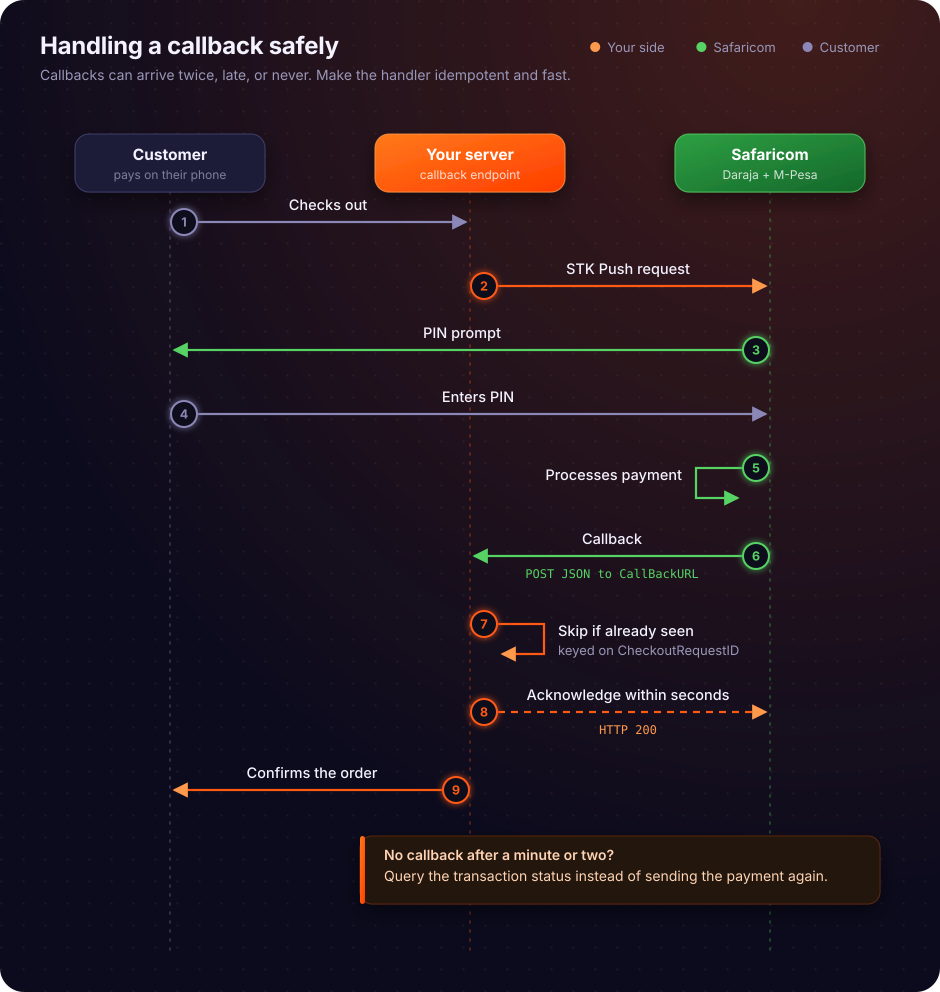

# Callback mechanisms

## Callback Mechanisms

The transition from the synchronous request-response cycle of initiating an STK Push, as detailed in the previous section, to the asynchronous callback mechanism is the most critical juncture in the Mpesa Daraja integration lifecycle. While the initial request confirms that Safaricom’s gateway has accepted the transaction command, it does not confirm that the customer has entered their PIN or that the funds have been successfully moved; that confirmation is delivered exclusively through the callback mechanism, which serves as the definitive source of truth for transaction finality.

### The Fundamental Necessity of Callbacks: Polling vs. Callbacks

To understand the architecture of Mpesa integration, one must first distinguish between the two primary methods of state synchronization: polling and callbacks. Polling is a pull-based communication pattern where a client, in this case, the merchant’s server, repeatedly requests the status of a transaction from the server (Safaricom’s Mpesa platform). In a polling-based architecture, the merchant’s application would maintain a loop, perhaps querying the `QueryTransactionStatus` API every five seconds to determine if a `CheckoutRequestID` has transitioned from "PENDING" to "COMPLETED" or "FAILED."

The drawbacks of polling are systemic and severe. First, it introduces artificial latency; if the polling interval is set to ten seconds, the merchant’s system will, on average, be five seconds behind the actual transaction state. Second, it creates an immense, unnecessary load on the infrastructure of both the merchant and Safaricom. If a merchant processes 1,000 transactions simultaneously, a polling frequency of once every five seconds results in 12,000 requests per minute, the vast majority of which return the same "PENDING" status. This consumes network bandwidth, CPU cycles, and database connections without providing any new information. Third, polling requires the merchant to manage complex state machines to track which transactions are still active, when they were last checked, and how to handle timeouts in the polling loop itself.

Callbacks, or webhooks, represent a push-based communication paradigm that resolves these inefficiencies. In this model, the merchant’s server exposes a publicly accessible URL—the listener endpoint—and registers this URL with Safaricom. When the transaction state changes, Safaricom’s platform proactively sends an HTTP POST request to that endpoint. This ensures that the merchant’s system is notified exactly when the event occurs, with zero polling overhead. The callback mechanism is not merely an optimization; it is the standard for high-throughput, real-time financial systems where the cost of delayed state updates includes lost revenue, customer dissatisfaction, and operational reconciliation errors.

### Core Concepts and Mechanisms of the Callback Architecture

A webhook is defined as a user-defined HTTP callback that is triggered by specific events within a source system. In the context of Mpesa, the "source system" is the Mpesa Daraja platform, and the "event" is the finalization of a payment transaction. The listener endpoint is the destination for these events. It must be a server capable of receiving and parsing HTTP POST requests.

The HTTP POST method is the transport vehicle for these callbacks. Unlike the GET method, which is intended for data retrieval and should be idempotent (meaning multiple identical requests should have the same effect as a single request), the POST method is designed to send data to a server for processing. When Safaricom sends a callback, it includes a JSON payload in the request body. This payload contains the transaction metadata, such as the `MpesaReceiptNumber`, `Amount`, `PhoneNumber`, and the `ResultCode`. The `ResultCode` is the most important field in the payload; a value of `0` indicates success, while any non-zero value indicates a failure, with the `ResultDesc` field providing the human-readable reason for that failure.

### Mpesa Daraja Callback Architecture and Data Flow

The lifecycle of a callback begins the moment the customer completes the STK Push prompt on their mobile device. Once the customer enters their PIN and the Mpesa core banking system processes the debit, Safaricom’s Daraja platform triggers the callback generation engine. This engine packages the transaction results into a structured JSON object.

The data flow follows a strict sequence:
1.  **Transaction Finalization**: The Mpesa core system updates the transaction status.
2.  **Payload Construction**: The Daraja platform generates a JSON object. For an STK Push, this object is nested within a `Body` -> `stkCallback` structure.
3.  **HTTP POST Transmission**: The Daraja platform initiates an HTTP POST request to the merchant’s registered URL.
4.  **Network Transit**: The request travels over the public internet, typically secured via TLS (Transport Layer Security).
5.  **Endpoint Reception**: The merchant’s web server receives the request and routes it to the application logic.
6.  **Processing and Idempotency Check**: The application parses the JSON, checks if the `CheckoutRequestID` has already been processed, and updates the database.
7.  **Acknowledgment**: The application returns an HTTP 200 OK response to Safaricom.

The following sequence diagram illustrates this interaction:



### Implementation: Building a Resilient Listener Endpoint

A production-grade listener endpoint must be built with the assumption that the network is unreliable and that Safaricom will retry requests. The following Python Flask implementation demonstrates the necessary logic for receiving, validating, and acknowledging these callbacks.

```python
from flask import Flask, request, jsonify
import logging
from datetime import datetime

# Configure logging for auditability
logging.basicConfig(level=logging.INFO, format='%(asctime)s - %(levelname)s - %(message)s')

app = Flask(__name__)

# Simulated persistent storage
processed_transactions = set()

@app.route('/mpesa-callback', methods=['POST'])
def mpesa_callback():
    """
    Listener endpoint for Mpesa transaction results.
    """
    try:
        data = request.get_json()
        if not data:
            return jsonify({"ResultCode": "1", "ResultDesc": "Invalid JSON"}), 400

        # Extracting the STK Push callback structure
        stk_callback = data.get("Body", {}).get("stkCallback", {})
        checkout_request_id = stk_callback.get("CheckoutRequestID")
        result_code = stk_callback.get("ResultCode")
        
        # Idempotency check: Ensure we don't process the same callback twice
        if checkout_request_id in processed_transactions:
            logging.info(f"Duplicate callback received for {checkout_request_id}. Skipping.")
            return jsonify({"ResultCode": "0", "ResultDesc": "Already processed"}), 200

        # Processing logic
        if result_code == 0:
            logging.info(f"Transaction {checkout_request_id} successful.")
            # Update database status here
            processed_transactions.add(checkout_request_id)
        else:
            logging.error(f"Transaction {checkout_request_id} failed: {stk_callback.get('ResultDesc')}")

        # Acknowledge receipt
        return jsonify({"ResultCode": "0", "ResultDesc": "Success"}), 200

    except Exception as e:
        logging.error(f"Processing error: {e}")
        return jsonify({"ResultCode": "1", "ResultDesc": "Internal Error"}), 500
```

This implementation highlights the importance of the `processed_transactions` set. In a distributed production environment, this would be replaced by a Redis cache or a database table with a unique constraint on the `CheckoutRequestID`. Without this check, a retry from Safaricom could trigger duplicate order fulfillment or double-crediting of user accounts.

### Failure Modes and Operational Pitfalls

The most common failure mode in Mpesa integration is the "retry storm." If the merchant’s listener endpoint returns an HTTP 500 error or takes longer than the timeout threshold (typically 30 seconds) to respond, Safaricom will interpret this as a failure and retry the request. If the merchant’s system is not idempotent, these retries will cause data corruption.

Another frequent pitfall is the "firewall lockout." Because Safaricom’s servers originate the callback, the merchant must ensure that their firewall or cloud security group allows inbound traffic on the callback port (usually 80 or 443) specifically from Safaricom’s IP ranges. If the endpoint is behind a corporate proxy or a restrictive WAF (Web Application Firewall), the callback may be blocked entirely, leading to a silent failure where the merchant never receives the transaction result.

Furthermore, developers often fail to account for the "eventual consistency" of the callback. It is possible for a callback to arrive out of order if multiple transactions are being processed simultaneously. The merchant’s system must rely on the `ResultCode` and the `CheckoutRequestID` to determine the state, rather than assuming that the arrival time of the callback correlates with the transaction sequence.

### Security Considerations

Security in the callback mechanism is non-negotiable. Because the callback contains sensitive financial information, it must be transmitted over HTTPS. Using HTTP (port 80) exposes the transaction data to man-in-the-middle attacks, where an attacker could intercept the callback and modify the `ResultCode` to trick the merchant into fulfilling an unpaid order.

IP whitelisting is the second layer of defense. By restricting access to the listener endpoint to only the known IP addresses of the Mpesa Daraja platform, the merchant effectively eliminates the risk of malicious actors sending spoofed callbacks. While IP whitelisting is not a substitute for robust input validation, it significantly reduces the attack surface.

Finally, input validation is required to prevent injection attacks. Even though the payload is JSON, the values within the JSON (such as `PhoneNumber` or `MpesaReceiptNumber`) should be treated as untrusted input. The application must validate that these fields conform to the expected formats (e.g., MSISDN format for phone numbers) before using them in database queries or business logic.

### Advanced Operational Strategies: Asynchronous Processing

For high-volume merchants, the synchronous processing of callbacks within the request-response cycle is a performance bottleneck. If the database update or the order fulfillment logic takes several seconds, the listener endpoint will remain occupied, potentially leading to timeouts and retries from Safaricom.

The optimal architecture involves decoupling the reception from the processing. The listener endpoint should perform only three tasks:
1.  Validate the JSON structure.
2.  Push the raw payload into a persistent message queue (e.g., RabbitMQ, Redis, or Amazon SQS).
3.  Immediately return an HTTP 200 OK to Safaricom.

A separate worker process then consumes the messages from the queue and performs the heavy lifting of database updates and business logic. This ensures that the listener endpoint remains highly responsive, regardless of the complexity of the downstream processing. This pattern also provides a natural buffer against traffic spikes; if the system is overwhelmed, the message queue will hold the callbacks until the worker processes can catch up, preventing data loss.

### The Role of Idempotency in Distributed Systems

Idempotency is the property where an operation can be applied multiple times without changing the result beyond the initial application. In the context of Mpesa callbacks, idempotency is the primary defense against the inherent unreliability of distributed systems. Because network failures are inevitable, retries are a feature, not a bug, of the Daraja platform.

To implement idempotency effectively, the merchant must define a "unique transaction identifier" for every payment. For STK Push, this is the `CheckoutRequestID`. For C2B payments, this is the `TransID`. The database schema must enforce a unique constraint on this identifier. When a callback arrives, the application should attempt to insert the record into the database. If the database returns a "duplicate key" error, the application knows that the transaction has already been processed and can safely ignore the callback while still returning an HTTP 200 OK to Safaricom.

This approach is superior to checking for existence before inserting, as it avoids "race conditions" where two concurrent callbacks for the same transaction might both check for existence simultaneously, find nothing, and both proceed to process the transaction. By relying on database-level constraints, the system guarantees that the transaction is processed exactly once.

### Handling Network Timeouts and Latency

Network latency between Safaricom’s data centers and the merchant’s server can vary significantly. If the merchant’s server is hosted in a region with poor connectivity to the Mpesa gateway, the callback might experience high latency. If this latency exceeds the Daraja platform's timeout threshold, the callback will be marked as failed, and a retry will be triggered.

To mitigate this, merchants should host their listener endpoints in regions that are geographically close to the Mpesa infrastructure, or use a Content Delivery Network (CDN) or a global load balancer that can terminate the TLS connection closer to the source. Additionally, the application code should be optimized to minimize the time spent on I/O operations. Every millisecond saved in the listener endpoint is a millisecond of headroom against the timeout threshold.

### Monitoring and Alerting

A robust callback implementation requires proactive monitoring. The merchant should track the following metrics:
*   **Callback Success Rate**: The ratio of HTTP 200 OK responses to total incoming requests. A dip in this metric indicates a potential issue with the listener endpoint.
*   **Processing Latency**: The time taken from receiving the callback to returning the 200 OK response.
*   **Retry Frequency**: The number of callbacks received with the same `CheckoutRequestID`. A high frequency of retries suggests that the merchant’s system is failing to acknowledge callbacks in time.
*   **Error Logs**: Detailed logs of any HTTP 500 errors or parsing failures.

Alerting should be configured to trigger when these metrics deviate from established baselines. For example, an alert should fire if the number of 500 errors exceeds a certain threshold within a five-minute window, allowing the engineering team to investigate before the issue impacts a large number of transactions.

### The Mechanics of HTTP Headers in Callbacks

While the JSON body is the focus of most developers, the HTTP headers sent by Safaricom contain valuable information for debugging and security. The `User-Agent` header, for instance, can be used to verify that the request is indeed coming from the Mpesa platform. The `Content-Type` header confirms that the payload is indeed `application/json`.

In some advanced configurations, merchants may use custom headers to pass additional metadata, although this is not standard in the Mpesa Daraja API. The most important header is the `Host` header, which the web server uses to route the request to the correct virtual host. If the `Host` header is misconfigured, the request may be rejected by the web server before it even reaches the application code.

### Data Integrity and Schema Evolution

Safaricom may occasionally update the structure of the callback payload to include new fields or to support new features. A well-designed listener endpoint should be "defensive" in its parsing logic. Instead of assuming a rigid structure, the application should use safe access methods (like the `.get()` method in Python dictionaries) to extract fields. If a field is missing, the application should log a warning but attempt to process the transaction if the core fields (`ResultCode`, `CheckoutRequestID`, `Amount`) are present.

This defensive approach prevents the application from crashing when Safaricom introduces minor, non-breaking changes to the payload. It also allows the system to remain functional while the engineering team updates the parsing logic to accommodate the new schema.

### Comparison of Callback Patterns

| Pattern | Reliability | Complexity | Latency |
| :--- | :--- | :--- | :--- |
| **Direct Webhook** | Moderate | Low | Very Low |
| **Queue-Buffered Webhook** | High | Moderate | Low |
| **Polling** | Low | High | High |

The "Queue-Buffered Webhook" is the gold standard for production Mpesa integrations. It combines the low latency of a direct webhook with the high reliability of a message queue. By offloading the processing to a worker pool, the merchant gains the ability to handle massive bursts of traffic without risking timeouts or data loss.

### The Impact of TLS Versions on Callback Delivery

Safaricom’s Daraja platform enforces modern security standards, including the use of TLS 1.2 or higher. If the merchant’s server is configured to support only older, insecure versions of TLS (like TLS 1.0 or 1.1), the handshake will fail, and the callback will never be delivered. It is essential to ensure that the web server’s SSL/TLS configuration is up to date and that the certificate chain is complete and valid.

A common issue is the use of self-signed certificates. While these are acceptable for local development, they will be rejected by the Mpesa gateway in production. The merchant must use a certificate issued by a trusted Certificate Authority (CA).

### Handling Large-Scale Traffic Spikes

During peak periods, such as holidays or promotional events, the volume of Mpesa transactions can spike by orders of magnitude. A listener endpoint that is not designed for scale will quickly become a bottleneck. Horizontal scaling—adding more instances of the listener application—is the primary strategy for handling these spikes.

The load balancer should be configured to distribute incoming callbacks across the available instances. If the application is stateless (i.e., it does not store session data locally), scaling is straightforward. The use of a distributed cache like Redis for idempotency checks ensures that even if a callback is routed to a different instance than the previous one, the system will correctly identify it as a duplicate.

### The Role of Logging in Audit Trails

In the event of a dispute—for example, if a customer claims they paid but the merchant has no record of the transaction—the logs are the only source of truth. Every incoming callback should be logged in its entirety, including the raw JSON payload and the timestamp of receipt.

These logs should be stored in a secure, centralized location with a retention policy that aligns with financial audit requirements. The ability to replay a callback from the logs is an invaluable tool for debugging and for reconciling accounts after a system failure.

### Summary of Operational Best Practices

To summarize, a production-ready Mpesa callback listener must:
1.  **Be Idempotent**: Use unique transaction identifiers and database constraints to prevent duplicate processing.
2.  **Be Asynchronous**: Use a message queue to decouple reception from processing.
3.  **Be Secure**: Enforce HTTPS and IP whitelisting.
4.  **Be Defensive**: Use safe parsing logic to handle schema variations.
5.  **Be Monitored**: Track success rates, latency, and retry frequencies.
6.  **Be Scalable**: Design for horizontal scaling and statelessness.

By adhering to these principles, developers can build Mpesa integrations that are not only functional but also resilient, secure, and capable of handling the demands of a high-volume financial environment. The callback mechanism, when implemented with these considerations, transforms from a simple HTTP endpoint into a robust, reliable bridge between the Mpesa ecosystem and the merchant’s business logic.

### Troubleshooting Common Callback Errors

When a callback fails, the first step is to examine the logs of the web server. If there are no entries for the callback, the issue is likely at the network level—either the request is being blocked by a firewall, or the DNS resolution is failing. If the logs show a 404 error, the URL configured in the Daraja portal does not match the route defined in the application.

If the logs show a 400 error, the application is rejecting the payload. This usually happens when the JSON structure does not match the expected format or when required fields are missing. If the logs show a 500 error, the application logic is failing, likely due to an unhandled exception or a database connection issue.

By systematically checking these layers—network, routing, payload, and application logic—developers can quickly isolate and resolve the root cause of any callback delivery failure. The key is to maintain a clear, structured approach to debugging, ensuring that every component of the callback pipeline is verified.

### Final Considerations on System Design

The callback mechanism is the final piece of the transaction puzzle. It is the bridge that connects the customer's intent to the merchant's fulfillment. By treating the callback as a critical, asynchronous event rather than a simple HTTP request, developers can build systems that are truly robust. The transition from the synchronous request-response cycle to the asynchronous callback is not just a technical change; it is a shift in mindset from "wait for the answer" to "react to the event." This shift is the hallmark of a mature, professional integration with the Mpesa Daraja platform.

The complexity of the callback mechanism is a reflection of the complexity of the financial system it serves. Every retry, every idempotency check, and every security measure is a response to the realities of distributed computing and the high stakes of financial transactions. By mastering these mechanisms, the developer ensures that the merchant’s system is a reliable participant in the Mpesa ecosystem, capable of providing a seamless and trustworthy experience for the end customer.

The integration of Mpesa is a journey that begins with the initial API call and concludes with the successful processing of the callback. Each step in this journey is an opportunity to build resilience and reliability into the system. The callback mechanism, as the final step, is the most important, for it is here that the transaction is truly completed, and the value is finally realized.

### Deep Dive: The Anatomy of a Callback Payload

To fully grasp the callback mechanism, one must understand the structure of the payload. The `Body` object contains the `stkCallback` object, which is the heart of the notification. Within `stkCallback`, the `CallbackMetadata` object is where the actual transaction details reside. This is a list of items, each with a `Name` and a `Value`.

The `Item` list is dynamic. It may contain:
*   `Amount`: The value of the transaction.
*   `MpesaReceiptNumber`: The unique identifier for the transaction on the Mpesa ledger.
*   `TransactionDate`: The timestamp of the transaction.
*   `PhoneNumber`: The customer's phone number.

The dynamic nature of this list is why parsing logic must be flexible. The order of these items is not guaranteed, so the code must iterate through the list and extract the values by checking the `Name` field. This is a common point of failure for developers who assume a fixed index for these items.

### The Importance of Transactional Integrity

When processing a callback, the merchant’s system is essentially performing a distributed transaction. The Mpesa platform has already committed the transaction, and the merchant’s system must now commit the corresponding record in its own database. If the merchant’s system fails to commit, the two systems will be out of sync.

To maintain integrity, the database update must be atomic. If the application logic involves multiple steps—such as updating the order status, sending a notification, and logging the transaction—these steps should be wrapped in a single database transaction. If any step fails, the entire transaction should be rolled back, ensuring that the system remains in a consistent state.

This level of rigor is what separates a hobbyist integration from a professional-grade financial system. It acknowledges that failures are inevitable and that the system must be designed to handle them gracefully, maintaining the integrity of the data at all costs.

### The Future of Mpesa Callbacks

As the Mpesa ecosystem continues to evolve, the callback mechanism will likely become even more sophisticated. We may see the introduction of cryptographic signatures for callbacks, allowing merchants to verify the authenticity of the request beyond just IP whitelisting. We may also see more granular event types, allowing merchants to subscribe to specific events rather than receiving a generic transaction notification.

For now, the current callback architecture is a proven, reliable, and efficient way to handle transaction notifications. By mastering the principles of idempotency, asynchronous processing, and secure communication, developers can build integrations that are ready for the future, whatever it may bring.

### Final Synthesis

The callback mechanism is the heartbeat of the Mpesa Daraja integration. It is the mechanism that turns a simple API call into a real-time financial transaction. By understanding its fundamental necessity, its architectural flow, and the operational best practices required to implement it, developers can build systems that are not only functional but also resilient, secure, and scalable. The journey from the initial STK Push request to the final callback acknowledgment is a testament to the power of asynchronous, event-driven design in the modern digital economy. It is a journey that every Mpesa developer must take, and one that, when completed, results in a truly professional-grade integration.

The callback is not just a technical requirement; it is the promise of a reliable, real-time financial service. It is the mechanism that ensures that when a customer pays, the merchant knows, and the business continues. It is the foundation of trust in the digital payment ecosystem, and it is the responsibility of the developer to ensure that this foundation is as solid as possible.

This concludes the synthesis of the callback mechanism. The principles discussed here—idempotency, asynchronous processing, security, and monitoring—are the building blocks of a successful Mpesa integration. They are the tools that allow developers to navigate the complexities of the Daraja platform and to build systems that are worthy of the trust placed in them by both the merchant and the customer.

The callback mechanism is the final word in the transaction lifecycle. It is the definitive confirmation that the process has reached its conclusion. By treating it with the care and attention it deserves, developers ensure that their systems are not just connected to Mpesa, but are truly integrated, providing a seamless and reliable experience for everyone involved.

The callback mechanism is the ultimate test of an integration's robustness. It is where the theory of the API meets the reality of the network. It is where the developer's design choices are put to the test, and where the true quality of the system is revealed. By following the best practices outlined in this segment, developers can ensure that their systems pass this test with flying colors, time and time again.

The callback mechanism is the bridge between the digital and the physical, between the intent and the fulfillment. It is the mechanism that makes the Mpesa ecosystem work, and it is the mechanism that every developer must master. It is the final piece of the puzzle, and it is the most important one.

---

[← Daraja's request-response cycle](02-request-response-cycle.md) · [Credentials and OAuth 2.0 →](04-credentials-and-oauth.md)
